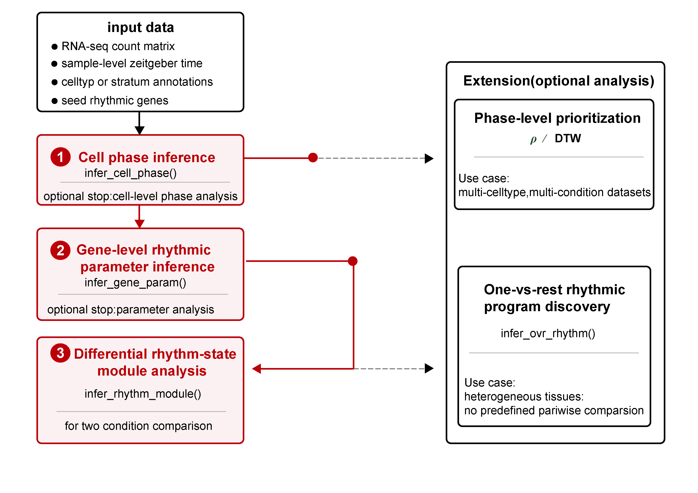

# scRhythmBayes 

[](https://github.com/Liwei-DynamicsLab/scRhythmBayes/actions/workflows/R-CMD-check.yaml)

**Cell-level circadian phase inference and rhythm-state remodeling for single-cell transcriptomes**

`scRhythmBayes` is an R package for phase-resolved circadian analysis in heterogeneous single-cell transcriptomic data.

The package is designed to infer latent cell-level circadian phase, estimate gene-level rhythmic parameters, and characterize condition- and cell-type-resolved rhythm-state remodeling. It provides a core workflow for cell phase inference, rhythmic parameter estimation, and differential rhythm-state module analysis, together with extension analyses for one-vs-rest rhythmic program discovery, DTW-based phase-distribution similarity, and circular phase-concentration rho analysis.

<p align="center">
  
</p>

## Overview

`scRhythmBayes` organizes single-cell circadian analysis into one core workflow and several extension workflows.

### Core workflow

The core workflow follows the main analysis logic of the method:

1. **Cell-level circadian phase inference**  
   Infer latent circadian phase for each cell from seed rhythmic genes.

2. **Gene-level rhythmic parameter inference**  
   Estimate rhythmic parameters, including mesor, mean expression, amplitude, phase, dropout rate, likelihood-ratio statistics, and FDR.

3. **Differential rhythm-state module analysis**  
   Classify genes into interpretable rhythm-state remodeling modules between two biological conditions.

### Extension analyses

Additional analysis branches are provided for heterogeneous or multi-cell-type datasets:

1. **One-vs-rest rhythmic program discovery**  
   Identify cell-type-specific rhythmic programs by comparing one target cell type against all remaining cell types.

2. **DTW-based phase-distribution similarity analysis**  
   Compare circular cell-phase distributions across celltype-by-condition combinations.

3. **Circular phase-concentration rho analysis**  
   Summarize the concentration of inferred cell phases within cell types, groups, and optional sample-level units.

## Installation

The package can be installed from GitHub:

```r
install.packages("remotes")
remotes::install_github("Liwei-DynamicsLab/scRhythmBayes")
```

Load the package:

```r
library(scRhythmBayes)
```

Check the installed version:

```r
packageVersion("scRhythmBayes")
```

Note: if the GitHub repository is private, installation requires GitHub authentication and repository access.

## Example data

`scRhythmBayes` includes an example dataset for testing the complete workflow.

```r
data("srb_example_data")

names(srb_example_data)
dim(srb_example_data$Count)
class(srb_example_data$Count)
dim(srb_example_data$meta)
head(srb_example_data$meta)
```

Example output:

```text
[1] "Count" "meta"  "truth"

[1]  138 2160

[1] "dgCMatrix"
attr(,"package")
[1] "Matrix"

[1] 2160   10

                       cell    sample replicate ZT celltype condition     T_true Theta_true Theta_noisy     r_sim
Cell_0001_001 Cell_0001_001 A_ZT00_R1         1  0        1         A 23.7745644 6.22416640   6.0883578 0.7240322
Cell_0001_002 Cell_0001_002 A_ZT00_R1         1  0        1         A 23.7111107 6.20755425   6.0324486 0.6303893
Cell_0001_003 Cell_0001_003 A_ZT00_R1         1  0        1         A 22.2182691 5.81672924   5.8263271 0.8666633
Cell_0001_004 Cell_0001_004 A_ZT00_R1         1  0        1         A  0.5581621 0.14612650   0.2245110 0.8593562
Cell_0001_005 Cell_0001_005 A_ZT00_R1         1  0        1         A  0.7203817 0.18859549   0.3327113 0.6901345
Cell_0001_006 Cell_0001_006 A_ZT00_R1         1  0        1         A  0.1788832 0.04683152   0.1722017 0.7564754
```

The example object contains:

| Object | Description |
|---|---|
| `srb_example_data$Count` | Gene-by-cell sparse count matrix with 138 genes and 2,160 cells |
| `srb_example_data$meta` | Cell-level metadata for 36 biological samples from two conditions, six ZT values, and three replicates |
| `srb_example_data$truth` | Gene-level M0--M7 and OVR truth, sample effects, and simulation settings |

Metadata columns:

| Column | Description |
|---|---|
| `cell` | Cell identifier matched to the count matrix column names |
| `sample` | Independent biological sample identifier |
| `replicate` | Biological replicate within each condition and ZT |
| `ZT` | Sampling Zeitgeber time |
| `celltype` | Simulated cell-type label |
| `condition` | Simulated group or condition label |
| `T_true` | Simulated true circadian time in hours |
| `Theta_true` | Simulated true circadian phase in radians |
| `Theta_noisy` | Simulated noisy cell phase in radians |
| `r_sim` | Simulated phase-reliability value |

`T_true` and `Theta_true` are available only in the simulated example dataset and are used for demonstration and validation. Real single-cell datasets usually do not contain these two columns.

Basic input objects:

```r
count <- srb_example_data$Count
metadata <- srb_example_data$meta
```

## Core workflow

### 1. Infer cell-level circadian phase

```r
res_phase <- infer_cell_phase(
  count = srb_example_data$Count,
  metadata = srb_example_data$meta,
  ZT_by = "ZT",
  strata_by = "celltype",
  Species = "mouse",
  setseed = 1,
  Verbose = FALSE
)

head(res_phase)
```

Example output:

```text
# A tibble: 6 × 7
  cell          ZT_input stratum theta_pred ZT_pred  Rbar r_cell
  <chr>            <dbl> <chr>        <dbl>   <dbl> <dbl>  <dbl>
1 Cell_0001_001        0 1            6.19   23.6   0.992  0.999
2 Cell_0001_002        0 1            6.23   23.8   0.991  0.999
3 Cell_0001_003        0 1            6.00   22.9   0.991  0.999
4 Cell_0001_004        0 1            6.14   23.4   0.989  0.999
5 Cell_0001_005        0 1            0.142   0.543 0.992  0.999
6 Cell_0001_006        0 1            0.137   0.524 0.991  0.999
```

Example output columns:

| Column | Description |
|---|---|
| `cell` | Cell barcode or cell ID |
| `ZT_input` | Observed sampling Zeitgeber time |
| `stratum` | Stratum used during phase inference |
| `theta_pred` | Inferred cell-level circadian phase in radians |
| `ZT_pred` | Inferred cell-level circadian phase converted to 24-hour time |
| `Rbar` | Aggregate phase concentration statistic |
| `r_cell` | Cell-level phase reliability weight |

### 2. Estimate gene-level rhythmic parameters

For a basic condition-comparison example, the gene-level model can be run within one cell type.

```r
cell_use <- as.character(metadata$celltype) == "1"

count_use <- count[, cell_use, drop = FALSE]
metadata_use <- metadata[cell_use, , drop = FALSE]

res_param <- infer_gene_param(
  count = count_use,
  metadata = metadata_use,
  theta_pred = res_phase$theta_pred[cell_use],
  r_cell = res_phase$r_cell[cell_use],
  strata_by = "condition",
  ZT_by = "ZT",
  sample_by = "sample",
  sample_boot_by = "ZT",
  B = 3,
  n_worker = 1,
  setseed = 1,
  Verbose = FALSE
)

head(res_param$param_long)
head(res_param$param_wide)
res_param$inference
```

Main outputs:

| Output | Description |
|---|---|
| `param_long` | Long-format gene-level rhythmic parameter estimates for each group |
| `param_wide` | Wide-format paired parameter table for downstream module analysis |
| `fit_diagnostics` | Cell-level working-likelihood fit diagnostics |
| `bootstrap_res` | Whole-sample bootstrap confidence interval results |
| `gene_eligibility` | Gene-level eligibility and sample-support diagnostics |
| `inference` | Sample-aware test mode, sample columns, and sample counts |

Common gene-level parameters include:

| Column | Description |
|---|---|
| `gene` | Gene name |
| `Mesor` | Baseline rhythmic expression level |
| `Mean` | Mean expression level |
| `Amplitude` | Circadian oscillation amplitude |
| `Amplitude_shrunk` | Joint MAP-shrunk rhythmic amplitude |
| `Phase` | Gene-level rhythmic phase in radians |
| `Alpha` | Dispersion-related parameter |
| `Dropout_rate` | Estimated dropout rate |
| `P_value` | Biological-sample cluster score-test P value |
| `FDR` | Multiple-testing adjusted sample-aware rhythmicity significance |

### 3. Infer differential rhythm-state modules

```r
res_module <- infer_rhythm_module(
  param_wide = res_param$param_wide,
  compare_by = "condition",
  group1 = "A",
  group2 = "B",
  Verbose = FALSE
)

head(
  res_module$module_result[
    c("gene", "FDR_A", "FDR_B", "module_map", "module_name")
  ]
)
```

Example output:

```text
# A tibble: 6 × 5
  gene  FDR_A  FDR_B module_map module_name
  <chr> <dbl>  <dbl>      <int> <chr>
1 M0G01 0.968 0.995           0 Non-rhythmic
2 M0G02 0.282 0.518           0 Non-rhythmic
3 M0G03 0.126 0.715           0 Non-rhythmic
4 M0G04 0.516 0.472           0 Non-rhythmic
5 M0G05 0.105 0.0661          0 Non-rhythmic
6 M0G06 0.381 0.0967          0 Non-rhythmic
```

The module analysis assigns genes to interpretable rhythm-state remodeling classes based on rhythmicity, amplitude remodeling, and phase remodeling between two groups.

### 4. Visualize rhythm-state modules

```r
hm_module <- plot_module_heatmap(
  count = count_use,
  res_phase = res_phase[cell_use, , drop = FALSE],
  gene_meta = res_module$module_result,
  metadata = metadata_use,
  group_by = "condition",
  group1 = "A",
  group2 = "B"
)

hm_module
plot(hm_module, module_id = 0)
```

```r
p_polar <- plot_module_polar(
  gene_meta = res_module$module_result,
  module_id = 7,
  group1 = "A",
  group2 = "B"
)

p_polar$plot
```

## Extension workflow 1: one-vs-rest rhythmic program discovery

The one-vs-rest branch is designed for heterogeneous tissues or multi-cell-type datasets. It compares each target cell type against all remaining cell types to identify cell-type-specific rhythmic programs.

```r
res_ovr <- infer_ovr_rhythm(
  count = count,
  metadata = metadata,
  theta_pred = res_phase$theta_pred,
  r_cell = res_phase$r_cell,
  group_by = "celltype",
  ZT_by = "ZT",
  target_groups = "1",
  q_cut = 0.05,
  amp_cut = 0.25,
  sample_by = "sample",
  sample_boot_by = "ZT",
  B = 3,
  n_worker = 1,
  setseed = 1,
  Verbose = FALSE
)

res_ovr$ovr_summary
head(res_ovr$ovr_markers)
```

Example output:

```text
# A tibble: 1 × 2
  celltype n_marker
  <chr>       <int>
1 1               5

# A tibble: 5 × 17
  gene    celltype Mesor_target Mesor_rest Delta_Mesor Mean_target Mean_rest Delta_Mean Amplitude_target Amplitude_rest Delta_Amp Phase_target Phase_rest Delta_Phase FDR_target FDR_rest ovr_marker
  <chr>   <chr>           <dbl>      <dbl>       <dbl>       <dbl>     <dbl>      <dbl>            <dbl>          <dbl>     <dbl>        <dbl>      <dbl>       <dbl>      <dbl>    <dbl> <lgl>
1 OVR1G01 1                1.54       1.62    -0.0793         4.66      5.05    -0.385              1.32         0.0528      1.27         1.07       2.10      -1.02    0.000123    0.536 TRUE
2 OVR1G02 1                1.41       1.46    -0.0524         4.08      4.30    -0.219              1.39         0.0173      1.37         2.05       5.78       2.56    0.000123    0.925 TRUE
3 OVR1G03 1                1.45       1.60    -0.155          4.25      4.96    -0.710              1.34         0.0443      1.29         3.07       3.74      -0.663   0.000123    0.542 TRUE
4 OVR1G04 1                1.84       1.84    -0.00477        6.29      6.32    -0.0301             1.26         0.0687      1.19         4.17       1.64       2.52    0.000123    0.295 TRUE
5 OVR1G06 1                1.69       1.78    -0.0971         5.39      5.94    -0.550              1.40         0.0423      1.36         6.27       5.10       1.16    0.000123    0.579 TRUE
```

Visualize one-vs-rest rhythmic programs:

```r
plot_ovr_curve(
  res_ovr,
  genes = res_ovr$ovr_markers$gene[1],
  target_group = "1"
)

ht_ovr <- plot_ovr_heatmap(
  count = count,
  res_phase = res_phase,
  ovr_result = res_ovr$ovr_result,
  metadata = metadata,
  celltype_by = "celltype",
  Verbose = FALSE
)

ht_ovr
plot(ht_ovr)
```

Main output columns:

| Column | Description |
|---|---|
| `gene` | Gene name |
| `celltype` | Target cell type |
| `Mesor_target`, `Mesor_rest` | Mesor in target and pooled rest groups |
| `FDR_target`, `FDR_rest` | Sample-aware rhythmicity FDR in target and rest groups |
| `Mean_target`, `Mean_rest` | Mean expression in target and rest groups |
| `Amplitude_target`, `Amplitude_rest` | Rhythmic amplitude in target and rest groups |
| `Phase_target`, `Phase_rest` | Rhythmic phase in target and rest groups |
| `Delta_Mean` | Target-minus-rest mean difference |
| `Delta_Amp` | Target-minus-rest amplitude difference |
| `Delta_Phase` | Circular target-minus-rest phase difference |
| `ovr_marker` | Whether the gene is classified as a target-specific rhythmic marker |

## Extension workflow 2: DTW-based phase-distribution similarity

The DTW branch compares circular phase distributions between celltype-by-condition combinations.

```r
dtw_res <- run_dtw_similarity(
  res_phase = res_phase,
  metadata = metadata,
  celltype_by = "celltype",
  group_by = "condition",
  n_bin = 24,
  min_cell = 10,
  normalize_distance = TRUE,
  Verbose = FALSE
)

dtw_res
head(dtw_res$histogram)
dtw_res$similarity
```

Example histogram output:

```text
  combo cell_type Group bin bin_start   bin_end   bin_mid       prop
1 1 | A         1     A   1 0.0000000 0.2617994 0.1308997 0.05833333
2 1 | A         1     A   2 0.2617994 0.5235988 0.3926991 0.02222222
3 1 | A         1     A   3 0.5235988 0.7853982 0.6544985 0.01666667
4 1 | A         1     A   4 0.7853982 1.0471976 0.9162979 0.06388889
5 1 | A         1     A   5 1.0471976 1.3089969 1.1780972 0.07500000
6 1 | A         1     A   6 1.3089969 1.5707963 1.4398966 0.01111111
```

Example similarity matrix:

```text
          1 | A     1 | B     2 | A     2 | B     3 | A     3 | B
1 | A 1.0000000 0.4730539 0.2743924 0.1117194 0.2089335 0.3072317
1 | B 0.4730539 1.0000000 0.0807574 0.1062086 0.0000000 0.1623240
2 | A 0.2743924 0.0807574 1.0000000 0.8754491 0.9337795 1.0000000
2 | B 0.1117194 0.1062086 0.8754491 1.0000000 0.8323353 0.9520958
3 | A 0.2089335 0.0000000 0.9337795 0.8323353 1.0000000 0.9628112
3 | B 0.3072317 0.1623240 1.0000000 0.9520958 0.9628112 1.0000000
```

Plot DTW similarity heatmap:

```r
ht_dtw <- plot_dtw_heatmap(
  dtw_res = dtw_res
)

ht_dtw
plot(ht_dtw)
```

Main outputs:

| Output | Description |
|---|---|
| `data` | Merged cell-level phase and metadata table |
| `histogram` | Circular phase histogram for each celltype-by-group combination |
| `distance` | Pairwise DTW distance matrix |
| `similarity` | Scaled 0-to-1 DTW similarity matrix |
| `annotation` | Annotation table for heatmap rows and columns |

## Extension workflow 3: circular phase-concentration rho analysis

The rho branch summarizes how concentrated inferred cell phases are within each cell type and condition.

### Group-level rho summary

```r
rho_res <- run_phase_rho(
  res_phase = res_phase,
  metadata = metadata,
  celltype_by = "celltype",
  group_by = "condition",
  theta_by = "theta_pred",
  group_levels = c("A", "B"),
  min_cell = 10,
  Verbose = FALSE
)

rho_res
```

Plot rho values:

```r
p_rho <- plot_phase_rho(rho_res)
p_rho$plot
```

### Sample-level rho summary

If a sample column is available, `run_phase_rho()` can also summarize rho at the sample level and perform sample-level group comparisons within each cell type.

The example dataset contains 36 independent biological samples in the `sample` column.

```r
rho_res_sample <- run_phase_rho(
  res_phase = res_phase,
  metadata = metadata,
  celltype_by = "celltype",
  group_by = "condition",
  sample_by = "sample",
  theta_by = "theta_pred",
  group_levels = c("A", "B"),
  compare_groups = c("A", "B"),
  min_cell = 10,
  Verbose = FALSE
)

head(rho_res_sample$rho_sample)
```

Example sample-level rho output:

```text
  cell_type Group    Sample n_cell       rho mean_phase_rad mean_phase_hour
1         1     A A_ZT00_R1     20 0.9812679    0.007222493      0.02758789
2         1     A A_ZT00_R2     20 0.9727272    6.261130650     23.91575741
3         1     A A_ZT00_R3     20 0.9724092    0.065011902      0.24832717
4         1     A A_ZT04_R1     20 0.9904582    1.116099149      4.26318472
5         1     A A_ZT04_R2     20 0.9595515    1.022346888      3.90507746
6         1     A A_ZT04_R3     20 0.9838027    0.999653055      3.81839340
```

Plot sample-level rho values:

```r
p_rho_sample <- plot_phase_rho(rho_res_sample)
p_rho_sample$plot
```

## Tutorials

Detailed tutorials are available through the pkgdown documentation website. These tutorials mirror the main analysis branches of `scRhythmBayes` and include step-by-step examples, output interpretation, and figure-generation workflows.

### Core workflow

- [Basic workflow: from cell phase inference to rhythm-state modules](https://liwei-dynamicslab.github.io/scRhythmBayes/articles/basic-workflow.html)

### Extension analyses

- [Rhythm-state module analysis](https://liwei-dynamicslab.github.io/scRhythmBayes/articles/module-analysis.html)
- [One-vs-rest rhythmic program discovery](https://liwei-dynamicslab.github.io/scRhythmBayes/articles/ovr-analysis.html)
- [DTW and rho phase-prioritization analysis](https://liwei-dynamicslab.github.io/scRhythmBayes/articles/phase-prioritization-dtw-rho.html)

The full documentation website is available at:

- [scRhythmBayes documentation](https://liwei-dynamicslab.github.io/scRhythmBayes/)

## Main functions

### Core workflow

| Function | Description |
|---|---|
| `infer_cell_phase()` | Infer cell-level circadian phase |
| `infer_gene_param()` | Estimate gene-level rhythmic parameters |
| `infer_rhythm_module()` | Infer differential rhythm-state modules |
| `plot_module_heatmap()` | Plot rhythm-state module heatmap |
| `plot_module_polar()` | Plot rhythm modules on polar coordinates |

### Phase visualization

| Function | Description |
|---|---|
| `plot_phase_scatter()` | Compare inferred phase with sampling time |
| `plot_phase_circle()` | Visualize circular cell-phase distributions |
| `plot_phase_flower()` | Visualize phase distributions by sampling time |
| `plot_phase_rose()` | Plot rose-style phase distributions |

### Extension analyses

| Function | Description |
|---|---|
| `infer_ovr_rhythm()` | Identify one-vs-rest cell-type-specific rhythmic programs |
| `plot_ovr_curve()` | Plot model-fitted target-versus-rest rhythmic curves |
| `plot_ovr_heatmap()` | Plot one-vs-rest rhythm-state heatmap |
| `run_dtw_similarity()` | Run DTW-based phase-distribution similarity analysis |
| `plot_dtw_heatmap()` | Plot DTW similarity or distance heatmap |
| `run_phase_rho()` | Summarize circular phase concentration rho |
| `plot_phase_rho()` | Plot rho by cell type and group |

## Notes

`scRhythmBayes` is intended for phase-resolved analysis of single-cell transcriptomic datasets where cells are collected across circadian or time-of-day sampling points. The core workflow focuses on latent cell-phase inference and rhythm-state remodeling analysis. The extension workflows support additional biological questions, including cell-type-specific rhythmic program discovery and comparison of inferred phase distributions across cell types and conditions.

The package is under active development. Function interfaces and tutorials may be updated as the manuscript and reproducibility workflows are finalized.

## Citation

If you use `scRhythmBayes`, please cite the associated manuscript:

Zhang Q, Li C, Zhang L. Decoding cell-level circadian phase and rhythm-state remodeling in single-cell transcriptomes with scRhythmBayes.

## License

This package is released under the MIT License.

## Authors

Liwei Zhang, Qian Zhang, and Chenyu Li.
