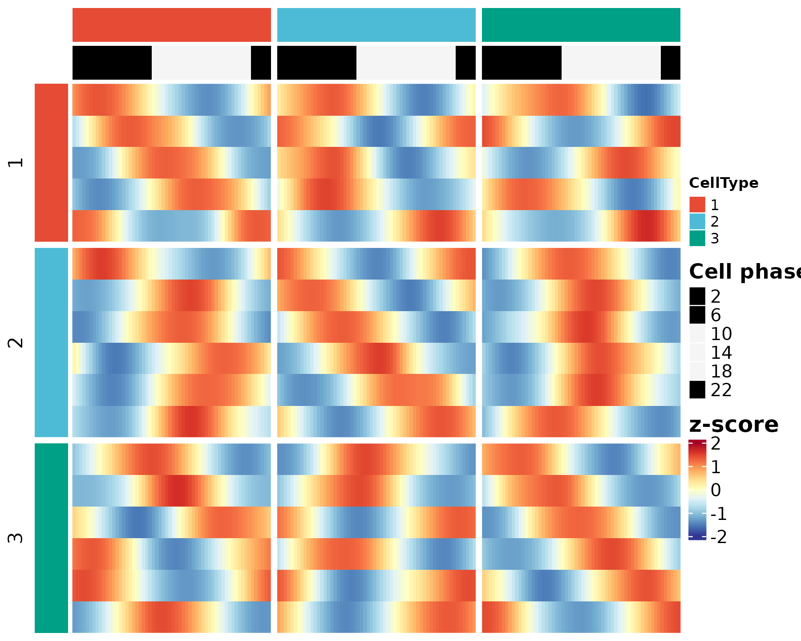
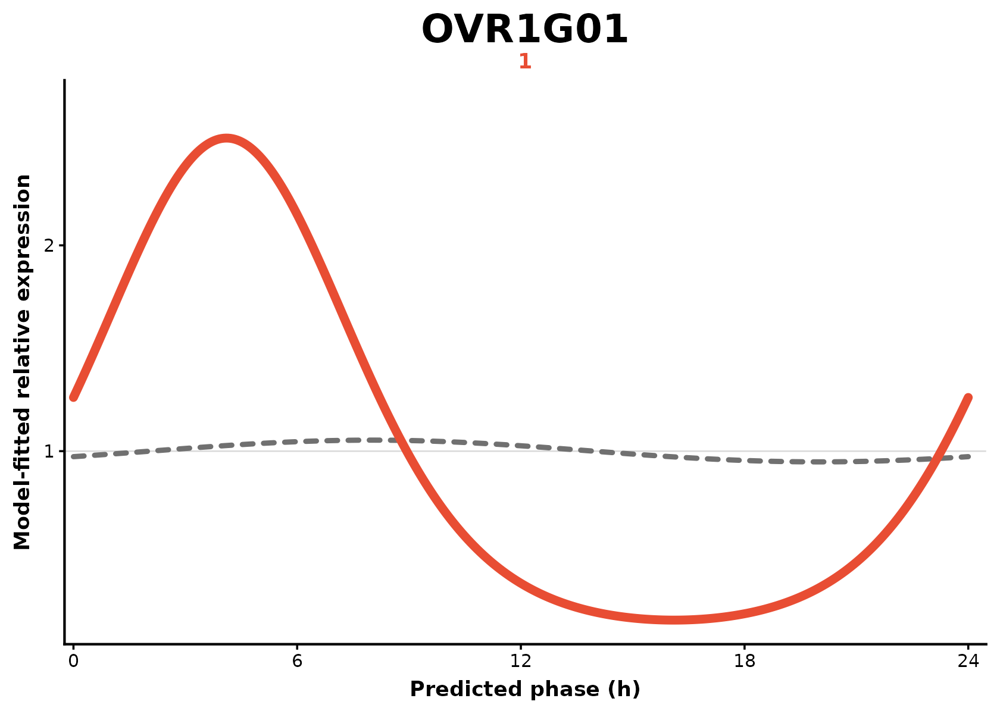

# One-vs-rest rhythmic program discovery

## Overview

This tutorial describes the one-vs-rest rhythmic program discovery
workflow in `scRhythmBayes`.

The one-vs-rest branch is designed for heterogeneous tissues and
multi-cell-type datasets. It compares one target cell type against all
remaining cell types and identifies cell-type-specific rhythmic
programs.

This branch starts from the gene-level rhythmic parameter layer. It is
different from pairwise rhythm-state module analysis:

| Analysis | Main question | Typical use case |
|----|----|----|
| Pairwise module analysis | How do rhythmic states differ between two predefined groups? | Condition `A` versus condition `B` within one cell type |
| One-vs-rest analysis | Which rhythmic programs are specific to one target cell type relative to all other cell types? | Cell-type-specific rhythmic program discovery in heterogeneous tissue |

In this tutorial, the workflow is:

1.  infer cell-level circadian phase;
2.  fit each target cell type and the pooled rest with sample-aware
    inference;
3.  inspect the OVR output table;
4.  visualize target-associated programs with a heatmap or fitted
    curves;
5.  extract target-specific candidate genes.

## Load package and example data

``` r

library(scRhythmBayes)

data("srb_example_data")

count <- srb_example_data$Count
metadata <- srb_example_data$meta
```

``` r

dim(count)
#> NULL
head(metadata)
#>                        cell    sample replicate ZT celltype condition
#> Cell_0001_001 Cell_0001_001 A_ZT00_R1         1  0        1         A
#> Cell_0001_002 Cell_0001_002 A_ZT00_R1         1  0        1         A
#> Cell_0001_003 Cell_0001_003 A_ZT00_R1         1  0        1         A
#> Cell_0001_004 Cell_0001_004 A_ZT00_R1         1  0        1         A
#> Cell_0001_005 Cell_0001_005 A_ZT00_R1         1  0        1         A
#> Cell_0001_006 Cell_0001_006 A_ZT00_R1         1  0        1         A
#>                   T_true Theta_true Theta_noisy     r_sim
#> Cell_0001_001 23.7745644 6.22416640   6.0883578 0.7240322
#> Cell_0001_002 23.7111107 6.20755425   6.0324486 0.6303893
#> Cell_0001_003 22.2182691 5.81672924   5.8263271 0.8666633
#> Cell_0001_004  0.5581621 0.14612650   0.2245110 0.8593562
#> Cell_0001_005  0.7203817 0.18859549   0.3327113 0.6901345
#> Cell_0001_006  0.1788832 0.04683152   0.1722017 0.7564754
table(metadata$celltype)
#> 
#>   1   2   3 
#> 720 720 720
table(metadata$celltype, metadata$condition)
#>    
#>       A   B
#>   1 360 360
#>   2 360 360
#>   3 360 360
```

The two required input objects are:

| Object | Description |
|----|----|
| `count` | Gene-by-cell count matrix |
| `metadata` | Cell metadata containing cell IDs, sample IDs, cell types, conditions, and sampling time |

For the example dataset, `metadata$celltype` defines the cell-type
groups used for OVR testing.

## Step 1: infer cell-level circadian phase

The OVR workflow first requires a cell-level circadian phase estimate.
Here, phase is inferred using `celltype` as the stratum.

``` r

res_phase <- infer_cell_phase(
  count = count,
  metadata = metadata,
  ZT_by = "ZT",
  strata_by = "celltype",
  Species = "mouse",
  setseed = 1,
  Verbose = FALSE
)

head(res_phase)
#> # A tibble: 6 × 7
#>   cell          ZT_input stratum theta_pred ZT_pred  Rbar r_cell
#>   <chr>            <dbl> <chr>        <dbl>   <dbl> <dbl>  <dbl>
#> 1 Cell_0001_001        0 1            6.19   23.6   0.992  0.999
#> 2 Cell_0001_002        0 1            6.23   23.8   0.991  0.999
#> 3 Cell_0001_003        0 1            6.00   22.9   0.991  0.999
#> 4 Cell_0001_004        0 1            6.14   23.4   0.989  0.999
#> 5 Cell_0001_005        0 1            0.142   0.543 0.992  0.999
#> 6 Cell_0001_006        0 1            0.137   0.524 0.991  0.999
```

The key output columns used downstream are:

| Column | Description |
|----|----|
| `cell` | Cell identifier |
| `theta_pred` | Inferred cell-level circadian phase in radians |
| `ZT_pred` | Inferred cell-level circadian phase converted to 24-hour time |
| `r_cell` | Cell-level phase reliability weight |

## Step 2: run one-vs-rest analysis

[`infer_ovr_rhythm()`](https://liwei-dynamicslab.github.io/scRhythmBayes/reference/infer_ovr_rhythm.md)
fits each target cell type and the pooled rest directly. Supplying
`sample_by = "sample"` uses independent biological samples for
rhythmicity testing. The complete three-target example takes a few
minutes; use `target_groups = "1"` for a shorter first run.

``` r

res_ovr <- infer_ovr_rhythm(
  count = count,
  metadata = metadata,
  theta_pred = res_phase$theta_pred,
  r_cell = res_phase$r_cell,
  group_by = "celltype",
  ZT_by = "ZT",
  target_groups = c("1", "2", "3"),
  q_cut = 0.05,
  amp_cut = 0.25,
  sample_by = "sample",
  sample_boot_by = "ZT",
  B = 3,
  n_worker = 1,
  setseed = 1,
  Verbose = FALSE
)

head(res_ovr$ovr_result)
#> # A tibble: 6 × 17
#>   gene  celltype Mesor_target Mesor_rest Delta_Mesor Mean_target Mean_rest
#>   <chr> <chr>           <dbl>      <dbl>       <dbl>       <dbl>     <dbl>
#> 1 M0G01 1                1.77       1.56      0.209         5.85      4.74
#> 2 M0G02 1                1.90       2.06     -0.163         6.69      7.87
#> 3 M0G03 1                2.22       2.09      0.129         9.20      8.08
#> 4 M0G04 1                1.46       1.74     -0.281         4.30      5.70
#> 5 M0G05 1                1.54       1.41      0.129         4.67      4.11
#> 6 M0G06 1                1.88       1.91     -0.0285        6.57      6.76
#> # ℹ 10 more variables: Delta_Mean <dbl>, Amplitude_target <dbl>,
#> #   Amplitude_rest <dbl>, Delta_Amp <dbl>, Phase_target <dbl>,
#> #   Phase_rest <dbl>, Delta_Phase <dbl>, FDR_target <dbl>, FDR_rest <dbl>,
#> #   ovr_marker <lgl>
res_ovr$ovr_summary
#> # A tibble: 3 × 2
#>   celltype n_marker
#>   <chr>       <int>
#> 1 1               5
#> 2 2               6
#> 3 3               6
```

The main thresholds are:

| Argument | Description |
|----|----|
| `q_cut` | FDR cutoff for rhythmicity |
| `amp_cut` | Minimum target-group amplitude cutoff used for target-specific calls |

``` r

table(res_ovr$ovr_result$ovr_marker, useNA = "ifany")
#> 
#> FALSE  TRUE 
#>   397    17
```

## Interpret the OVR result

The OVR result is a gene-by-target-cell-type table.

| Column | Meaning |
|----|----|
| `gene` | Gene name |
| `celltype` | Target cell type being tested |
| `FDR_target`, `FDR_rest` | Sample-aware rhythmicity FDR in Target and Rest |
| `Mesor_target`, `Mesor_rest` | Fitted log-scale mesor values |
| `Mean_target`, `Mean_rest` | Fitted baseline means |
| `Amplitude_target`, `Amplitude_rest` | Fitted rhythmic amplitudes |
| `Phase_target`, `Phase_rest` | Fitted phases in radians |
| `Delta_Mean` | Target-minus-rest mean difference |
| `Delta_Amp` | Target-minus-rest amplitude difference |
| `ovr_marker` | Whether the gene is classified as target-specific |

A typical target-specific rhythmic program is expected to have strong
rhythmic evidence and sufficient amplitude in the target cell type, with
weaker or absent rhythmic evidence in the pooled rest.

## Step 4: plot the OVR heatmap

The OVR heatmap visualizes target-associated rhythmic programs across
the heterogeneous dataset.

``` r

ht_ovr <- plot_ovr_heatmap(
  count = count,
  res_phase = res_phase,
  ovr_result = res_ovr$ovr_result,
  metadata = metadata,
  celltype_by = "celltype",
  Verbose = FALSE
)

ht_ovr
#> scRhythmOVRHeatmap object
#> Genes: 17
#> Smoothed phase columns: 180
#>   TargetCellType n_target_gene n_cells
#> 1              1             5     720
#> 2              2             6     720
#> 3              3             6     720
plot(ht_ovr)
```



The heatmap is intended to help inspect whether OVR-selected genes show
cell-type-associated phase-resolved expression patterns.

## Step 5: plot fitted Target-versus-Rest curves

The curve function reproduces the original Figure 5F design from the
fitted harmonic parameters retained by
[`infer_ovr_rhythm()`](https://liwei-dynamicslab.github.io/scRhythmBayes/reference/infer_ovr_rhythm.md).
Each Target and Rest trajectory is normalized to mean one; no second
smoother is fitted.

``` r

gene_1 <- res_ovr$ovr_markers$gene[res_ovr$ovr_markers$celltype == "1"][1]

plot_ovr_curve(
  res_ovr,
  genes = gene_1,
  target_group = "1"
)
```



## Step 6: extract target-specific candidates

The `ovr_marker` column can be used to extract candidate
cell-type-specific rhythmic genes.

``` r

target_specific <- res_ovr$ovr_markers

head(target_specific)
#> # A tibble: 6 × 17
#>   gene    celltype Mesor_target Mesor_rest Delta_Mesor Mean_target Mean_rest
#>   <chr>   <chr>           <dbl>      <dbl>       <dbl>       <dbl>     <dbl>
#> 1 OVR1G01 1                1.54       1.62    -0.0793         4.66      5.05
#> 2 OVR1G02 1                1.41       1.46    -0.0524         4.08      4.30
#> 3 OVR1G03 1                1.45       1.60    -0.155          4.25      4.96
#> 4 OVR1G04 1                1.84       1.84    -0.00477        6.29      6.32
#> 5 OVR1G06 1                1.69       1.78    -0.0971         5.39      5.94
#> 6 OVR2G01 2                1.92       1.99    -0.0668         6.82      7.29
#> # ℹ 10 more variables: Delta_Mean <dbl>, Amplitude_target <dbl>,
#> #   Amplitude_rest <dbl>, Delta_Amp <dbl>, Phase_target <dbl>,
#> #   Phase_rest <dbl>, Delta_Phase <dbl>, FDR_target <dbl>, FDR_rest <dbl>,
#> #   ovr_marker <lgl>
```

The number of target-specific genes depends on signal strength, the
selected thresholds, and the structure of the dataset.

``` r

if (nrow(target_specific) > 0) {
  table(target_specific$celltype)
}
#> 
#> 1 2 3 
#> 5 6 6
```

If no target-specific genes are detected in a small example dataset,
this does not indicate function failure. In real datasets, users may
adjust `q_cut` and `amp_cut` based on the expected signal and desired
stringency.

## Recommended minimal workflow

``` r

res_phase <- infer_cell_phase(
  count = count,
  metadata = metadata,
  ZT_by = "ZT",
  strata_by = "celltype",
  Species = "mouse",
  setseed = 1,
  Verbose = FALSE
)

res_ovr <- infer_ovr_rhythm(
  count = count,
  metadata = metadata,
  theta_pred = res_phase$theta_pred,
  r_cell = res_phase$r_cell,
  group_by = "celltype",
  ZT_by = "ZT",
  target_groups = "1",
  sample_by = "sample",
  sample_boot_by = "ZT",
  B = 3,
  n_worker = 1,
  setseed = 1,
  Verbose = FALSE
)

ht_ovr <- plot_ovr_heatmap(
  count = count,
  res_phase = res_phase,
  ovr_result = res_ovr$ovr_result,
  metadata = metadata,
  celltype_by = "celltype",
  Verbose = FALSE
)

plot(ht_ovr)
```

## Notes for real datasets

For real datasets, the OVR workflow is most useful when:

1.  the dataset contains multiple biologically meaningful cell types;
2.  cell types have sufficient cell numbers for rhythmic parameter
    estimation;
3.  the user wants cell-type-specific rhythmic programs rather than a
    predefined pairwise condition comparison;
4.  the target cell type may have rhythmic genes that are absent,
    weaker, or phase-shifted in the rest of the tissue.

For direct comparison of two selected groups, use
[`infer_rhythm_module()`](https://liwei-dynamicslab.github.io/scRhythmBayes/reference/infer_rhythm_module.md)
instead. For target-versus-all discovery across many cell types, use
[`infer_ovr_rhythm()`](https://liwei-dynamicslab.github.io/scRhythmBayes/reference/infer_ovr_rhythm.md).

## Session information

``` r

sessionInfo()
#> R version 4.6.2 (2026-10-29)
#> Platform: x86_64-pc-linux-gnu
#> Running under: Ubuntu 24.04.5 LTS
#> 
#> Matrix products: default
#> BLAS:   /usr/lib/x86_64-linux-gnu/openblas-pthread/libblas.so.3 
#> LAPACK: /usr/lib/x86_64-linux-gnu/openblas-pthread/libopenblasp-r0.3.26.so;  LAPACK version 3.12.0
#> 
#> locale:
#>  [1] LC_CTYPE=C.UTF-8       LC_NUMERIC=C           LC_TIME=C.UTF-8       
#>  [4] LC_COLLATE=C.UTF-8     LC_MONETARY=C.UTF-8    LC_MESSAGES=C.UTF-8   
#>  [7] LC_PAPER=C.UTF-8       LC_NAME=C              LC_ADDRESS=C          
#> [10] LC_TELEPHONE=C         LC_MEASUREMENT=C.UTF-8 LC_IDENTIFICATION=C   
#> 
#> time zone: UTC
#> tzcode source: system (glibc)
#> 
#> attached base packages:
#> [1] stats     graphics  grDevices utils     datasets  methods   base     
#> 
#> other attached packages:
#> [1] tidyr_1.3.2         tibble_3.3.1        dplyr_1.2.1        
#> [4] Matrix_1.7-6        purrr_1.2.2         future_1.82.0      
#> [7] scRhythmBayes_2.0.0
#> 
#> loaded via a namespace (and not attached):
#>   [1] RColorBrewer_1.1-3     shape_1.4.6.1          jsonlite_2.0.0        
#>   [4] magrittr_2.0.5         spatstat.utils_3.2-5   farver_2.1.2          
#>   [7] rmarkdown_2.32         GlobalOptions_0.1.4    fs_2.1.0              
#>  [10] ragg_1.5.2             vctrs_0.7.3            ROCR_1.0-12           
#>  [13] spatstat.explore_3.8-3 htmltools_0.5.9        sass_0.4.10           
#>  [16] sctransform_0.4.3      parallelly_1.50.0      KernSmooth_2.23-27    
#>  [19] bslib_0.12.0           htmlwidgets_1.6.4      desc_1.4.3            
#>  [22] ica_1.0-3              plyr_1.8.9             plotly_4.12.1         
#>  [25] zoo_1.9-1              cachem_1.1.0           igraph_2.3.4          
#>  [28] mime_0.13              lifecycle_1.0.5        iterators_1.0.14      
#>  [31] pkgconfig_2.0.3        R6_2.6.1               fastmap_1.2.0         
#>  [34] clue_0.3-68            fitdistrplus_1.2-6     shiny_1.14.0          
#>  [37] digest_0.6.39          colorspace_2.1-4       furrr_0.4.0           
#>  [40] S4Vectors_0.50.3       patchwork_1.3.2        Seurat_5.6.0          
#>  [43] tensor_1.5.1           RSpectra_0.16-2        irlba_2.4.1           
#>  [46] textshaping_1.0.5      labeling_0.4.3         progressr_1.1.0       
#>  [49] spatstat.sparse_3.2-0  httr_1.4.9             polyclip_1.10-7       
#>  [52] abind_1.4-8            mgcv_1.9-4             compiler_4.6.2        
#>  [55] withr_3.0.3            doParallel_1.0.17      S7_0.2.2              
#>  [58] fastDummies_1.7.6      MASS_7.3-66            rjson_0.2.23          
#>  [61] tools_4.6.2            lmtest_0.9-40          otel_0.2.0            
#>  [64] httpuv_1.6.17          future.apply_1.21.0    goftest_1.2-3         
#>  [67] glue_1.8.1             nlme_3.1-171           promises_1.5.0        
#>  [70] grid_4.6.2             Rtsne_0.17             cluster_2.1.8.3       
#>  [73] reshape2_1.4.5         generics_0.1.4         gtable_0.3.6          
#>  [76] spatstat.data_3.1-9    data.table_1.18.6.1    sp_2.2-4              
#>  [79] utf8_1.2.6             BiocGenerics_0.58.1    spatstat.geom_3.8-3   
#>  [82] RcppAnnoy_0.0.23       ggrepel_0.9.8          RANN_2.6.3            
#>  [85] foreach_1.5.2          pillar_1.11.1          stringr_1.6.0         
#>  [88] spam_2.11-4            RcppHNSW_0.7.0         later_1.4.8           
#>  [91] circlize_0.4.18        splines_4.6.2          lattice_0.23-1        
#>  [94] survival_3.8-12        deldir_2.0-4           tidyselect_1.2.1      
#>  [97] ComplexHeatmap_2.28.0  miniUI_0.1.2           pbapply_1.7-5         
#> [100] knitr_1.52             gridExtra_2.3.1        IRanges_2.46.0        
#> [103] scattermore_1.2        stats4_4.6.2           xfun_0.62             
#> [106] matrixStats_1.5.0      stringi_1.8.9          yaml_2.3.12           
#> [109] evaluate_1.0.5         codetools_0.2-20       cli_3.6.6             
#> [112] uwot_0.2.5             xtable_1.8-8           reticulate_1.47.0     
#> [115] systemfonts_1.3.2      jquerylib_0.1.4        Rcpp_1.1.2            
#> [118] globals_0.20.0         spatstat.random_3.5-2  png_0.1-9             
#> [121] spatstat.univar_3.2-0  parallel_4.6.2         pkgdown_2.2.1         
#> [124] ggplot2_4.0.3          dotCall64_1.2          listenv_1.1.0         
#> [127] viridisLite_0.4.3      scales_1.4.0           ggridges_0.5.7        
#> [130] crayon_1.5.3           SeuratObject_5.4.0     GetoptLong_1.1.1      
#> [133] rlang_1.3.0            cowplot_1.2.0
```
