# Basic workflow: from cell phase inference to rhythm-state modules

## Overview

`scRhythmBayes` is designed for phase-resolved circadian analysis of
heterogeneous single-cell transcriptomic data.

This tutorial demonstrates the basic workflow using the built-in example
dataset. The workflow follows three core analysis layers:

1.  **Cell-level circadian phase inference**  
    Infer a latent circadian phase for each cell.

2.  **Gene-level rhythmic parameter inference**  
    Estimate rhythmic parameters, including mesor, mean expression,
    amplitude, phase, dropout rate, likelihood-ratio statistics, and
    FDR.

3.  **Differential rhythm-state module analysis**  
    Classify genes into interpretable rhythm-state remodeling modules
    between two biological groups.

The main example compares condition `A` versus condition `B` within one
cell type. This is the recommended starting point for two-condition
rhythm-state remodeling analysis. The tutorial also shows how the same
module framework can compare two cell types when gene-level parameters
are estimated by `celltype`.

Extension analyses, including one-vs-rest rhythmic program discovery,
DTW-based phase-distribution similarity, and circular
phase-concentration rho analysis, are introduced briefly at the end and
described in separate tutorials.

## Load package

``` r
library(scRhythmBayes)
```

## Load example data

`scRhythmBayes` includes a simulated example dataset for testing the
complete workflow.

``` r
data("srb_example_data")

names(srb_example_data)
#> [1] "Count" "meta"  "truth"
```

The example object contains a gene-by-cell count matrix and cell-level
metadata.

``` r
dim(srb_example_data$Count)
#> NULL
class(srb_example_data$Count)
#> [1] "dgCMatrix"
#> attr(,"package")
#> [1] "Matrix"

dim(srb_example_data$meta)
#> [1] 2160   10
head(srb_example_data$meta)
#>                        cell    sample replicate ZT celltype condition
#> Cell_0001_001 Cell_0001_001 A_ZT00_R1         1  0        1         A
#> Cell_0001_002 Cell_0001_002 A_ZT00_R1         1  0        1         A
#> Cell_0001_003 Cell_0001_003 A_ZT00_R1         1  0        1         A
#> Cell_0001_004 Cell_0001_004 A_ZT00_R1         1  0        1         A
#> Cell_0001_005 Cell_0001_005 A_ZT00_R1         1  0        1         A
#> Cell_0001_006 Cell_0001_006 A_ZT00_R1         1  0        1         A
#>                   T_true Theta_true Theta_noisy     r_sim
#> Cell_0001_001 23.7745644 6.22416640   6.0883578 0.7240322
#> Cell_0001_002 23.7111107 6.20755425   6.0324486 0.6303893
#> Cell_0001_003 22.2182691 5.81672924   5.8263271 0.8666633
#> Cell_0001_004  0.5581621 0.14612650   0.2245110 0.8593562
#> Cell_0001_005  0.7203817 0.18859549   0.3327113 0.6901345
#> Cell_0001_006  0.1788832 0.04683152   0.1722017 0.7564754
```

The two main input objects are:

| Object                   | Description                      |
|--------------------------|----------------------------------|
| `srb_example_data$Count` | Gene-by-cell sparse count matrix |
| `srb_example_data$meta`  | Cell-level metadata              |

The metadata contains:

| Column | Description |
|----|----|
| `cell` | Cell identifier |
| `sample` | Independent biological sample |
| `replicate` | Replicate within condition and ZT |
| `ZT` | Sampling Zeitgeber time |
| `celltype` | Cell-type label |
| `condition` | Condition or group label |
| `T_true` | Simulated true circadian time in hours |
| `Theta_true` | Simulated true circadian phase in radians |
| `Theta_noisy`, `r_sim` | Simulated noisy phase truth retained for validation |

`T_true` and `Theta_true` are available only in the simulated example
dataset. Real single-cell datasets usually do not contain these two
columns.

For convenience, define the input count matrix and metadata:

``` r
count <- srb_example_data$Count
metadata <- srb_example_data$meta
```

## Choosing the analysis design

Before running gene-level rhythmic parameter inference, users should
define the biological comparison of interest. In `scRhythmBayes`, the
same core framework can support several common designs.

| Analysis goal | Recommended design | Parameter grouping | Downstream analysis |
|----|----|----|----|
| Compare two conditions within one cell type | Subset one cell type, then compare conditions | `strata_by = "condition"` | `infer_rhythm_module(group1 = "A", group2 = "B")` |
| Compare two cell types directly | Use all relevant cells, then estimate parameters by cell type | `strata_by = "celltype"` | `infer_rhythm_module(group1 = "1", group2 = "2")` |
| Identify cell-type-specific rhythmic programs | Estimate parameters by cell type | `strata_by = "celltype"` | [`infer_ovr_rhythm()`](https://liwei-dynamicslab.github.io/scRhythmBayes/reference/infer_ovr_rhythm.md) |
| Compare phase distributions across cell types and conditions | Use cell-level phase result and metadata | not required | [`run_dtw_similarity()`](https://liwei-dynamicslab.github.io/scRhythmBayes/reference/run_dtw_similarity.md) or [`run_phase_rho()`](https://liwei-dynamicslab.github.io/scRhythmBayes/reference/run_phase_rho.md) |

The recommended starting point is a two-condition comparison within one
biologically defined cell type. This design is usually the clearest
setting for interpreting differential rhythm-state modules.

A direct cell-type comparison and a one-vs-rest analysis answer
different questions. A direct module comparison tests one selected pair,
such as cell type `1` versus cell type `2`. A one-vs-rest analysis
identifies target-specific rhythmic programs by comparing each target
cell type against all remaining cell types.

## Step 1: infer cell-level circadian phase

### Input

The phase inference step requires:

| Argument    | Description                                                   |
|-------------|---------------------------------------------------------------|
| `count`     | Gene-by-cell count matrix                                     |
| `metadata`  | Cell-level metadata                                           |
| `ZT_by`     | Column containing sampling Zeitgeber time                     |
| `strata_by` | Column defining strata for phase inference, such as cell type |
| `Species`   | Species used for selecting default seed rhythmic genes        |

### Run phase inference

``` r
res_phase <- infer_cell_phase(
  count = count,
  metadata = metadata,
  ZT_by = "ZT",
  strata_by = "celltype",
  Species = "mouse",
  setseed = 1,
  Verbose = TRUE
)

head(res_phase)
#> # A tibble: 6 × 7
#>   cell          ZT_input stratum theta_pred ZT_pred  Rbar r_cell
#>   <chr>            <dbl> <chr>        <dbl>   <dbl> <dbl>  <dbl>
#> 1 Cell_0001_001        0 1            6.19   23.6   0.992  0.999
#> 2 Cell_0001_002        0 1            6.23   23.8   0.991  0.999
#> 3 Cell_0001_003        0 1            6.00   22.9   0.991  0.999
#> 4 Cell_0001_004        0 1            6.14   23.4   0.989  0.999
#> 5 Cell_0001_005        0 1            0.142   0.543 0.992  0.999
#> 6 Cell_0001_006        0 1            0.137   0.524 0.991  0.999
```

### Output

The output contains one row per cell.

| Column | Description |
|----|----|
| `cell` | Cell identifier |
| `ZT_input` | Observed sampling Zeitgeber time |
| `stratum` | Stratum used during phase inference |
| `theta_pred` | Inferred cell-level circadian phase in radians |
| `ZT_pred` | Inferred cell-level circadian phase converted to 24-hour time |
| `Rbar` | Aggregate phase concentration statistic |
| `r_cell` | Cell-level phase reliability weight |

The inferred cell phase is used as the latent temporal coordinate for
downstream gene-level rhythmic parameter estimation.

### Phase diagnostic plots

If simulated true time is available, inferred phase can be compared
against the known true time.

``` r
p_phase <- plot_phase_scatter(
  res_phase = res_phase,
  metadata = metadata,
  truth_by = "T_true",
  pred_by = "ZT_pred"
)

p_phase$plot
```

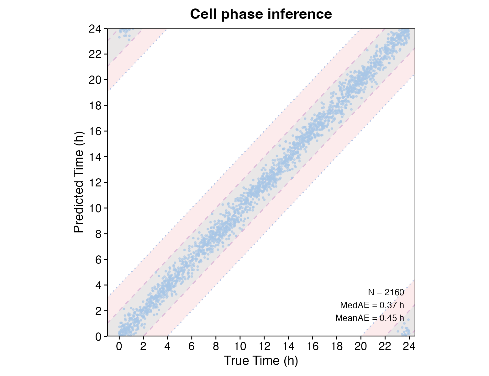

For real datasets, true phase is usually unknown. In that case, circular
phase distributions can be inspected by condition or cell type.

``` r
p_circle_condition <- plot_phase_circle(
  res_phase = res_phase,
  metadata = metadata,
  group_by = "condition",
  theta_by = "theta_pred"
)

p_circle_condition$plot
```

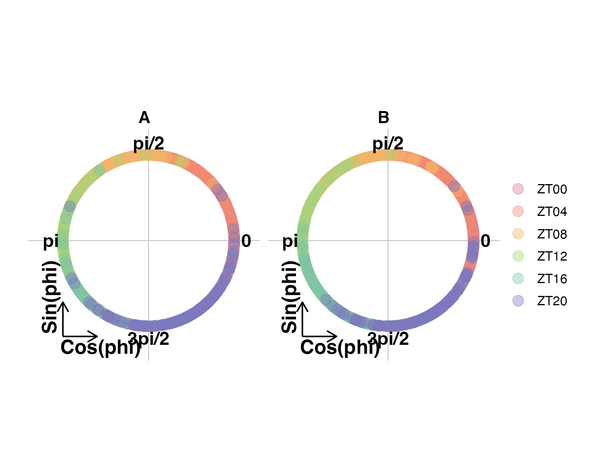

``` r
p_circle_celltype <- plot_phase_circle(
  res_phase = res_phase,
  metadata = metadata,
  group_by = "celltype",
  theta_by = "theta_pred"
)

p_circle_celltype$plot
```

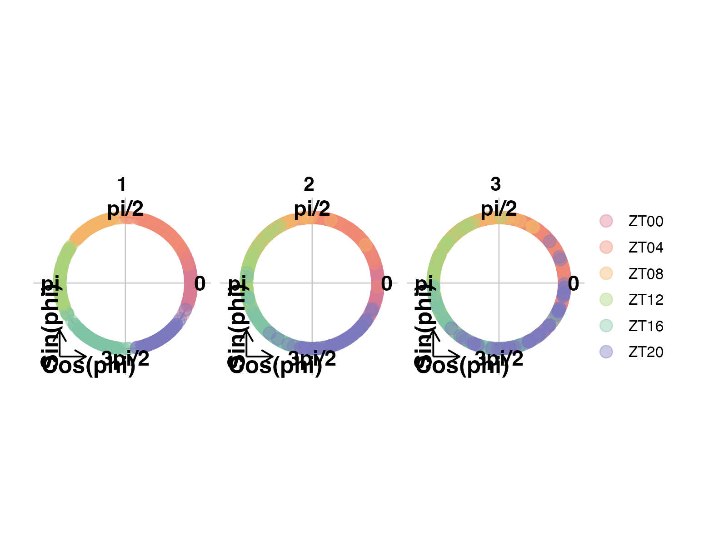

## Step 2: select one cell type for two-condition comparison

The core module workflow is designed for a defined two-group comparison.
In this example, we compare condition `A` and condition `B` within cell
type `1`.

``` r
cell_use <- as.character(metadata$celltype) == "1"

count_use <- count[, cell_use, drop = FALSE]
metadata_use <- metadata[cell_use, , drop = FALSE]
res_phase_use <- res_phase[cell_use, , drop = FALSE]

dim(count_use)
#> [1] 138 720
table(metadata_use$condition)
#> 
#>   A   B 
#> 360 360
```

This design mirrors a typical biological analysis where rhythmic
remodeling is tested within a defined cell type or tissue compartment.

## Step 3: estimate gene-level rhythmic parameters

### Input

The gene-level model requires:

| Argument | Description |
|----|----|
| `count` | Gene-by-cell count matrix for the selected analysis subset |
| `metadata` | Metadata for the selected cells |
| `theta_pred` | Inferred cell-level phase |
| `r_cell` | Cell-level phase reliability weight |
| `strata_by` | Grouping variable for parameter estimation |
| `sample_by` | Independent biological-sample column |
| `sample_boot_by` | Optional sample-bootstrap stratum, here ZT |

For condition-level module analysis within one cell type, use
`strata_by = "condition"`. For cell-type-level comparison, use
`strata_by = "celltype"` on the full dataset or a larger subset.
Supplying `sample_by = "sample"` prevents cells from the same sample
being treated as independent biological replicates.

### Run condition-level rhythmic parameter inference

``` r
res_param <- infer_gene_param(
  count = count_use,
  metadata = metadata_use,
  theta_pred = res_phase_use$theta_pred,
  r_cell = res_phase_use$r_cell,
  strata_by = "condition",
  ZT_by = "ZT",
  sample_by = "sample",
  sample_boot_by = "ZT",
  B = 3,
  n_worker = 1,
  setseed = 1,
  Verbose = TRUE
)
```

### Optional: run cell-type-level rhythmic parameter inference

This second parameter table is used only to demonstrate a direct cell
type `1` versus cell type `2` module comparison.

``` r
res_param_celltype <- infer_gene_param(
  count = count,
  metadata = metadata,
  theta_pred = res_phase$theta_pred,
  r_cell = res_phase$r_cell,
  strata_by = "celltype",
  ZT_by = "ZT",
  sample_by = "sample",
  sample_boot_by = "ZT",
  B = 3,
  n_worker = 1,
  setseed = 1,
  Verbose = FALSE
)
```

### Output

The result contains long-format and wide-format gene-level parameter
tables.

``` r
head(res_param$param_long)
#>    gene condition    Mesor     Mean  Amplitude Amplitude_shrunk     Phase
#> 1 M0G01         A 1.755320 5.785298 0.01436746       0.01430728 2.8477570
#> 2 M0G02         A 1.921771 6.833052 0.13579497       0.13523794 0.8647751
#> 3 M0G03         A 2.204746 9.067948 0.11505040       0.11465868 3.6479931
#> 4 M0G04         A 1.426698 4.164923 0.07420760       0.07369124 5.1644391
#> 5 M0G05         A 1.539609 4.662766 0.16339559       0.16243396 1.3293299
#> 6 M0G06         A 1.902031 6.699489 0.08399906       0.08362891 4.5692592
#>        Alpha Dropout_rate P_value       FDR
#> 1 0.08455367    0.1359375  0.9685 0.9685000
#> 2 0.10384658    0.1192342  0.2306 0.2816177
#> 3 0.10989510    0.1215711  0.0990 0.1265000
#> 4 0.06151541    0.2681402  0.4694 0.5159667
#> 5 0.07776356    0.2308580  0.0808 0.1051925
#> 6 0.08152373    0.1846818  0.3260 0.3812542
head(res_param_celltype$param_long)
#>    gene celltype    Mesor     Mean  Amplitude Amplitude_shrunk    Phase
#> 1 M0G01        1 1.765637 5.845292 0.00889543      0.008871299 3.072023
#> 2 M0G02        1 1.900013 6.685982 0.10204195      0.101765425 1.375553
#> 3 M0G03        1 2.219384 9.201665 0.05967664      0.059542043 3.171094
#> 4 M0G04        1 1.458644 4.300126 0.02556369      0.025455620 3.148994
#> 5 M0G05        1 1.541282 4.670576 0.11520103      0.114714455 2.373254
#> 6 M0G06        1 1.882987 6.573111 0.09375249      0.093506380 4.388659
#>        Alpha Dropout_rate P_value        FDR
#> 1 0.08430892    0.1338014  0.9700 0.97000000
#> 2 0.09606152    0.1366277  0.2129 0.23317619
#> 3 0.11122516    0.1174976  0.2802 0.30209063
#> 4 0.07364731    0.2538706  0.8417 0.86040444
#> 5 0.11453135    0.2159386  0.0950 0.11016807
#> 6 0.07861295    0.1495521  0.0557 0.06626379
res_param$inference
#> $mode
#> [1] "restricted_null_cluster_multiplier_score"
#> 
#> $sample_by
#> [1] "sample"
#> 
#> $sample_boot_by
#> [1] "ZT"
#> 
#> $P_value
#> [1] "restricted-null biological-sample cluster multiplier score test with Rademacher weights"
#> 
#> $LRT
#> [1] "original cell-independence working-likelihood diagnostic only"
#> 
#> $CI
#> [1] "whole-sample pairs bootstrap for top 100 ranked genes only"
#> 
#> $fixed_inputs
#> [1] "theta_pred"   "r_cell"       "size_factors"
#> 
#> $sample_counts
#>  A  B 
#> 18 18 
#> 
#> $effect_size
#> [1] "joint MAP shrinkage may change only the added shrunk coefficient/amplitude columns; sample-aware P_value/FDR remain score-test based"
```

``` r
head(res_param$param_wide)
#> # A tibble: 6 × 22
#>   gene  Mesor_A Mesor_B Mean_A Mean_B Amplitude_A Amplitude_B Amplitude_shrunk_A
#>   <chr>   <dbl>   <dbl>  <dbl>  <dbl>       <dbl>       <dbl>              <dbl>
#> 1 M0G01    1.76    1.78   5.79   5.93      0.0144     0.00395             0.0143
#> 2 M0G02    1.92    1.88   6.83   6.58      0.136      0.101               0.135 
#> 3 M0G03    2.20    2.23   9.07   9.31      0.115      0.0534              0.115 
#> 4 M0G04    1.43    1.49   4.16   4.43      0.0742     0.0876              0.0737
#> 5 M0G05    1.54    1.55   4.66   4.70      0.163      0.197               0.162 
#> 6 M0G06    1.90    1.87   6.70   6.49      0.0840     0.104               0.0836
#> # ℹ 14 more variables: Amplitude_shrunk_B <dbl>, Phase_A <dbl>, Phase_B <dbl>,
#> #   Alpha_A <dbl>, Alpha_B <dbl>, Dropout_rate_A <dbl>, Dropout_rate_B <dbl>,
#> #   FDR_A <dbl>, FDR_B <dbl>, Delta_Mesor <dbl>, Delta_Mean <dbl>,
#> #   Delta_Amp <dbl>, Delta_Amp_shrunk <dbl>, Delta_Phase <dbl>
head(res_param_celltype$param_wide)
#> # A tibble: 6 × 25
#>   gene  Mesor_1 Mesor_2 Mesor_3 Mean_1 Mean_2 Mean_3 Amplitude_1 Amplitude_2
#>   <chr>   <dbl>   <dbl>   <dbl>  <dbl>  <dbl>  <dbl>       <dbl>       <dbl>
#> 1 M0G01    1.77    1.66    1.44   5.85   5.26   4.20     0.00890      0.0453
#> 2 M0G02    1.90    2.13    1.99   6.69   8.42   7.30     0.102        0.0622
#> 3 M0G03    2.22    2.12    2.05   9.20   8.36   7.79     0.0597       0.120 
#> 4 M0G04    1.46    1.68    1.79   4.30   5.38   5.99     0.0256       0.0395
#> 5 M0G05    1.54    1.42    1.41   4.67   4.13   4.08     0.115        0.0554
#> 6 M0G06    1.88    1.96    1.87   6.57   7.07   6.46     0.0938       0.0683
#> # ℹ 16 more variables: Amplitude_3 <dbl>, Amplitude_shrunk_1 <dbl>,
#> #   Amplitude_shrunk_2 <dbl>, Amplitude_shrunk_3 <dbl>, Phase_1 <dbl>,
#> #   Phase_2 <dbl>, Phase_3 <dbl>, Alpha_1 <dbl>, Alpha_2 <dbl>, Alpha_3 <dbl>,
#> #   Dropout_rate_1 <dbl>, Dropout_rate_2 <dbl>, Dropout_rate_3 <dbl>,
#> #   FDR_1 <dbl>, FDR_2 <dbl>, FDR_3 <dbl>
```

Main output objects:

| Object | Description |
|----|----|
| `param_long` | Long-format gene-level rhythmic parameter estimates for each group |
| `param_wide` | Wide-format paired parameter table for downstream module analysis |
| `bootstrap_res` | Bootstrap confidence interval results when available |

Common gene-level parameters:

| Column             | Description                                        |
|--------------------|----------------------------------------------------|
| `gene`             | Gene name                                          |
| `Mesor`            | Baseline rhythmic expression level                 |
| `Mean`             | Mean expression level                              |
| `Amplitude`        | Circadian oscillation amplitude                    |
| `Amplitude_shrunk` | Empirical-Bayes stabilized amplitude               |
| `Phase`            | Gene-level rhythmic phase in radians               |
| `Alpha`            | Dispersion-related parameter                       |
| `Dropout_rate`     | Estimated dropout rate                             |
| `P_value`          | Rhythmicity P value from the active inference mode |
| `FDR`              | Multiple-testing adjusted rhythmicity significance |

## Step 4: infer differential rhythm-state modules

The rhythm-state module analysis compares rhythmic parameters between
two groups and assigns genes to interpretable remodeling classes.

### Input

| Argument | Description |
|----|----|
| `param_wide` | Wide-format paired gene parameter table from [`infer_gene_param()`](https://liwei-dynamicslab.github.io/scRhythmBayes/reference/infer_gene_param.md) |
| `compare_by` | Name of the comparison variable |
| `group1`, `group2` | Two groups to compare |
| `out_dir` | Optional output directory |

The `param_wide` object must match the selected groups. For example,
comparing `group1 = "A"` and `group2 = "B"` requires columns such as
`Mean_A`, `Mean_B`, `FDR_A`, `FDR_B`, `Amplitude_A`, `Amplitude_B`,
`Phase_A`, and `Phase_B`. Comparing `group1 = "1"` and `group2 = "2"`
requires columns such as `Mean_1`, `Mean_2`, `FDR_1`, `FDR_2`,
`Amplitude_1`, `Amplitude_2`, `Phase_1`, and `Phase_2`.

### Run condition-level module inference

``` r
res_module <- infer_rhythm_module(
  param_wide = res_param$param_wide,
  compare_by = "condition",
  group1 = "A",
  group2 = "B",
  out_dir = NULL,
  Verbose = TRUE
)

head(res_module$module_result)
#> # A tibble: 6 × 27
#>   gene  compare_by group1 group2 FDR_A  FDR_B Amplitude_A Amplitude_B Phase_A
#>   <chr> <chr>      <chr>  <chr>  <dbl>  <dbl>       <dbl>       <dbl>   <dbl>
#> 1 M0G01 condition  A      B      0.968 0.995           NA          NA      NA
#> 2 M0G02 condition  A      B      0.282 0.518           NA          NA      NA
#> 3 M0G03 condition  A      B      0.126 0.715           NA          NA      NA
#> 4 M0G04 condition  A      B      0.516 0.472           NA          NA      NA
#> 5 M0G05 condition  A      B      0.105 0.0661          NA          NA      NA
#> 6 M0G06 condition  A      B      0.381 0.0967          NA          NA      NA
#> # ℹ 18 more variables: Phase_B <dbl>, delta_phi_rad <dbl>, rA <dbl>, u <dbl>,
#> #   v <dbl>, seed_module <int>, module_map <int>, module_name <chr>,
#> #   post_M0 <dbl>, post_M1 <dbl>, post_M2 <dbl>, post_M3 <dbl>, post_M4 <dbl>,
#> #   post_M5 <dbl>, post_M6 <dbl>, post_M7 <dbl>, post_max <dbl>, margin <dbl>
```

### Optional: run direct cell-type-level module inference

This optional example compares cell type `1` and cell type `2` directly.
It uses `res_param_celltype$param_wide`, not `res_param$param_wide`,
because the wide-format columns must match the selected group labels.

``` r
res_module_celltype <- infer_rhythm_module(
  param_wide = res_param_celltype$param_wide,
  compare_by = "celltype",
  group1 = "1",
  group2 = "2",
  out_dir = NULL,
  Verbose = FALSE
)

head(res_module_celltype$module_result)
#> # A tibble: 6 × 27
#>   gene  compare_by group1 group2  FDR_1  FDR_2 Amplitude_1 Amplitude_2 Phase_1
#>   <chr> <chr>      <chr>  <chr>   <dbl>  <dbl>       <dbl>       <dbl>   <dbl>
#> 1 M0G01 celltype   1      2      0.97   0.493           NA          NA      NA
#> 2 M0G02 celltype   1      2      0.233  0.439           NA          NA      NA
#> 3 M0G03 celltype   1      2      0.302  0.0128          NA          NA      NA
#> 4 M0G04 celltype   1      2      0.860  0.781           NA          NA      NA
#> 5 M0G05 celltype   1      2      0.110  0.518           NA          NA      NA
#> 6 M0G06 celltype   1      2      0.0663 0.369           NA          NA      NA
#> # ℹ 18 more variables: Phase_2 <dbl>, delta_phi_rad <dbl>, rA <dbl>, u <dbl>,
#> #   v <dbl>, seed_module <int>, module_map <int>, module_name <chr>,
#> #   post_M0 <dbl>, post_M1 <dbl>, post_M2 <dbl>, post_M3 <dbl>, post_M4 <dbl>,
#> #   post_M5 <dbl>, post_M6 <dbl>, post_M7 <dbl>, post_max <dbl>, margin <dbl>
```

### Output

The module result contains gene-level comparison statistics and
posterior module assignments.

| Column | Description |
|----|----|
| `gene` | Gene name |
| `group1`, `group2` | Compared groups |
| `FDR_A`, `FDR_B` or `FDR_1`, `FDR_2` | Rhythmicity FDR in each group |
| `Amplitude_A`, `Amplitude_B` or `Amplitude_1`, `Amplitude_2` | Rhythmic amplitude in each group |
| `Phase_A`, `Phase_B` or `Phase_1`, `Phase_2` | Rhythmic phase in each group |
| `delta_phi_rad` | Phase shift between groups in radians |
| `module_name` | Assigned rhythm-state remodeling module |
| `post_max` | Maximum posterior module probability |
| `margin` | Difference between top posterior probabilities |

The module analysis summarizes whether genes retain rhythmicity, gain or
lose rhythmicity, change amplitude, shift phase, or show other
rhythm-state remodeling patterns between two groups.

## Step 5: visualize rhythm-state modules

### Module heatmaps

The module heatmap summarizes expression patterns of genes assigned to
rhythm-state modules. This tutorial shows all eight module IDs so users
can inspect the full module structure in the rendered HTML page.

``` r
hm_module <- plot_module_heatmap(
  count = count_use,
  res_phase = res_phase_use,
  gene_meta = res_module$module_result,
  metadata = metadata_use,
  group_by = "condition",
  group1 = "A",
  group2 = "B"
)

hm_module
#> scRhythmModuleHeatmap object
#>         module                   module_name n_gene_input n_gene_final
#> module0      0                  Non-rhythmic           24           24
#> module1      1                 Stable Rhythm           42           42
#> module2      2                   Rhythm Gain           12           12
#> module3      3                   Rhythm Loss           10           10
#> module4      4   Amplitude-enhanced rhythmic           12           12
#> module5      5 Amplitude-attenuated rhythmic           13           13
#> module6      6       Phase-advanced rhythmic           12           12
#> module7      7        Phase-delayed rhythmic           13           13
#>         ref_group status n_phase_ordered n_phase_missing
#> module0         A     ok               0              24
#> module1         A     ok              42               0
#> module2         B     ok              12               0
#> module3         A     ok              10               0
#> module4         B     ok              12               0
#> module5         A     ok              13               0
#> module6         A     ok              12               0
#> module7         A     ok              13               0
```

``` r
plot(hm_module, module_id = 0)
```

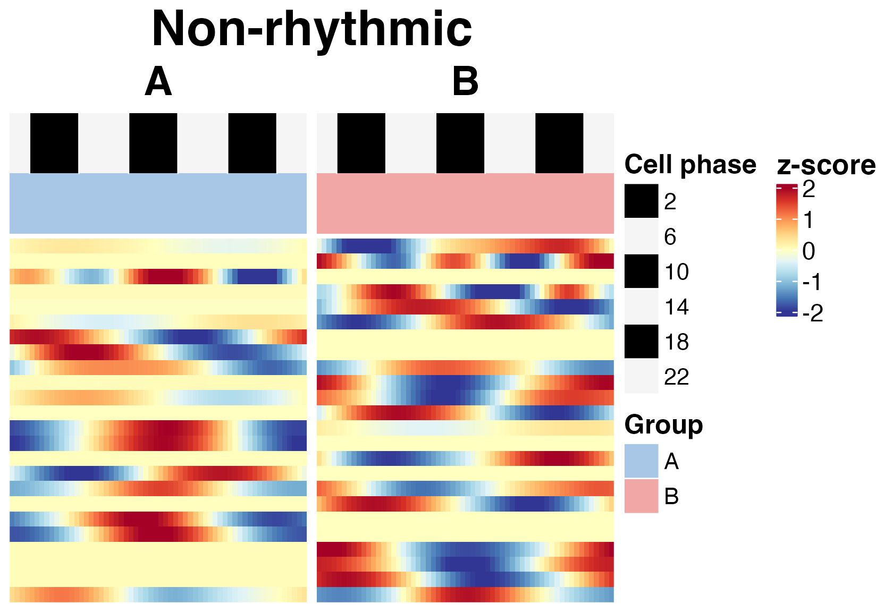

``` r
plot(hm_module, module_id = 1)
```

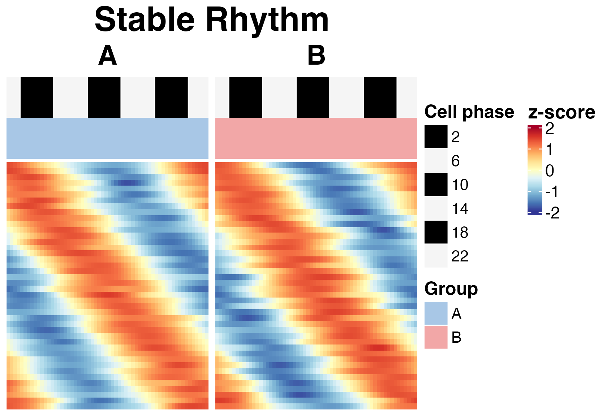

``` r
plot(hm_module, module_id = 2)
```

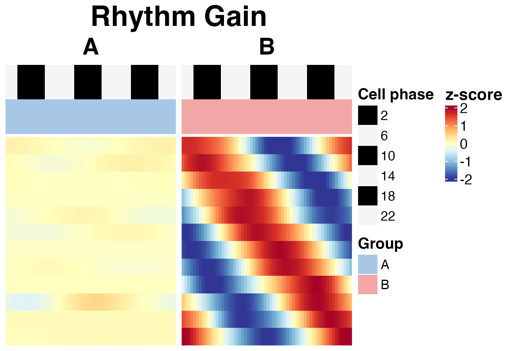

``` r
plot(hm_module, module_id = 3)
```

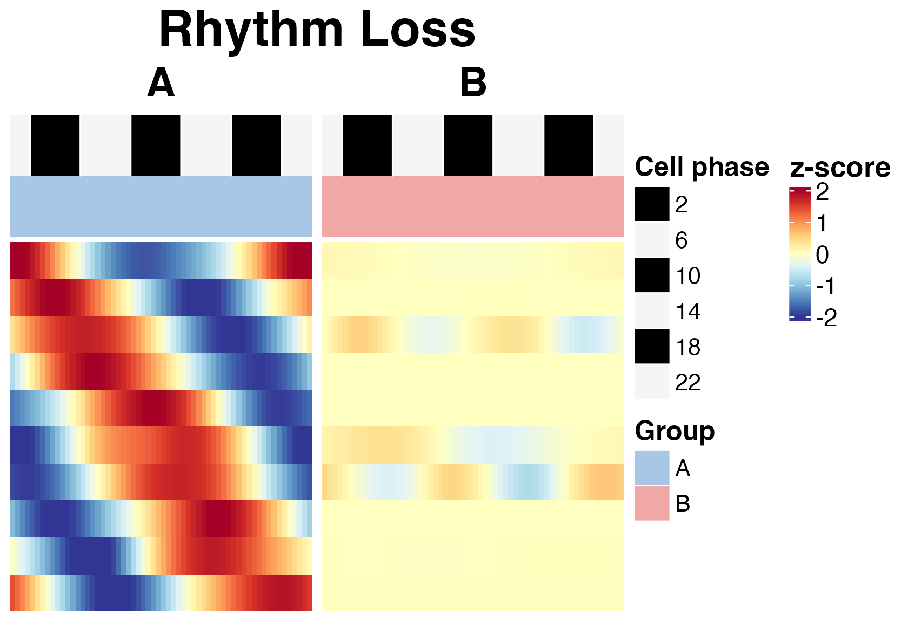

``` r
plot(hm_module, module_id = 4)
```

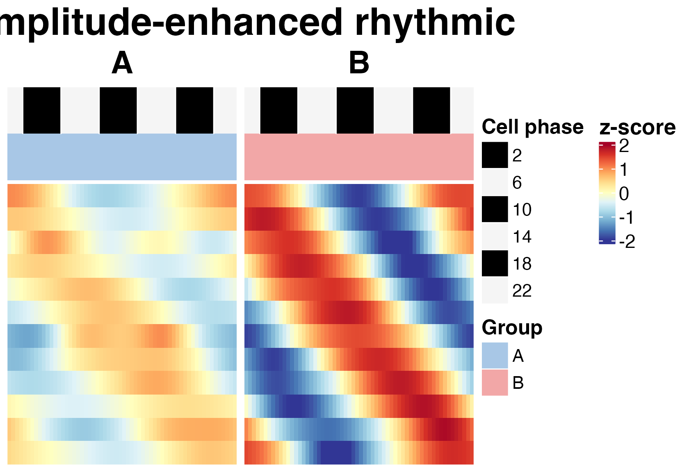

``` r
plot(hm_module, module_id = 5)
```

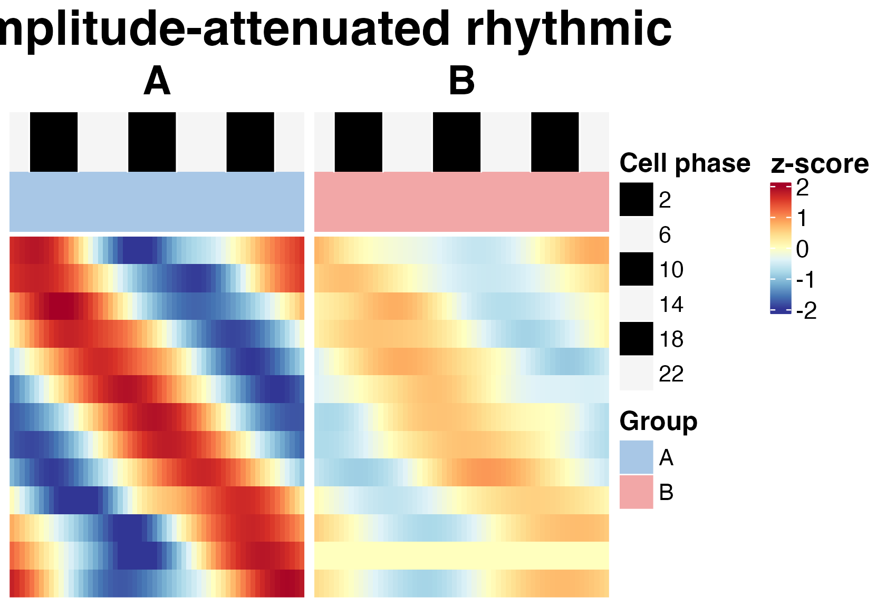

``` r
plot(hm_module, module_id = 6)
```

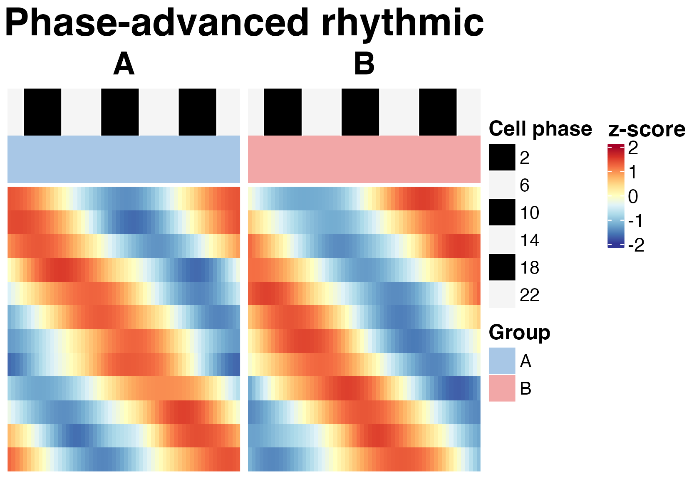

``` r
plot(hm_module, module_id = 7)
```

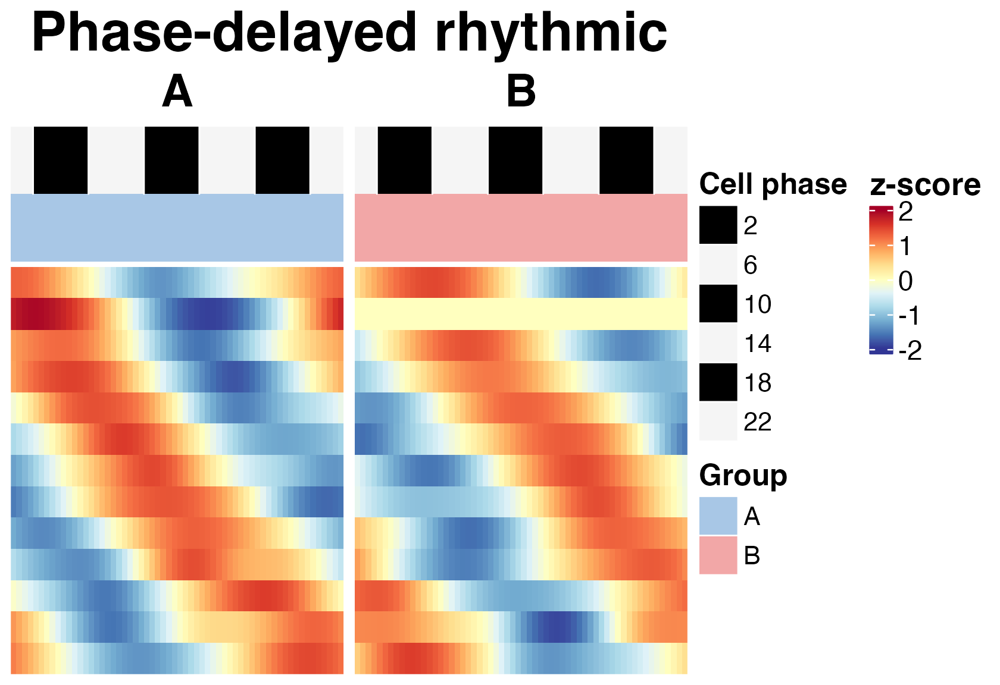

The heatmaps are useful for checking whether genes assigned to each
module show consistent phase-resolved expression patterns across the
compared conditions.

### Module polar plot

The polar plot visualizes rhythmic remodeling in amplitude-phase space.

``` r
p_polar <- plot_module_polar(
  gene_meta = res_module$module_result,
  module_id = 7,
  group1 = "A",
  group2 = "B"
)

p_polar$plot
```

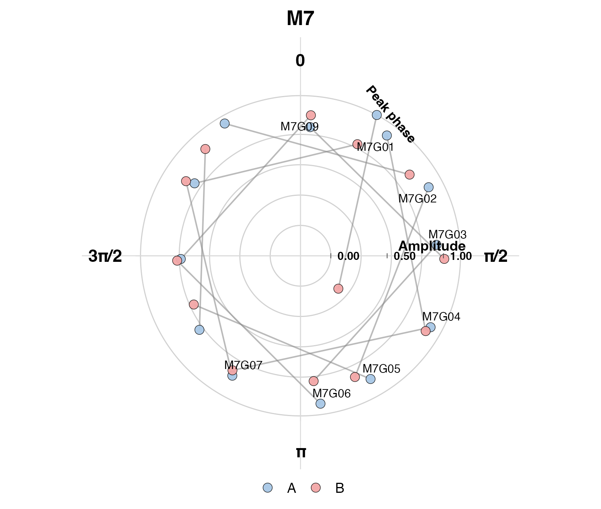

This plot helps inspect how genes in a selected module are distributed
by rhythmic amplitude and phase.

## Recommended minimal workflow

The minimal core workflow is:

``` r
data("srb_example_data")

count <- srb_example_data$Count
metadata <- srb_example_data$meta

res_phase <- infer_cell_phase(
  count = count,
  metadata = metadata,
  ZT_by = "ZT",
  strata_by = "celltype",
  Species = "mouse",
  setseed = 1,
  Verbose = FALSE
)

cell_use <- as.character(metadata$celltype) == "1"

res_param <- infer_gene_param(
  count = count[, cell_use, drop = FALSE],
  metadata = metadata[cell_use, , drop = FALSE],
  theta_pred = res_phase$theta_pred[cell_use],
  r_cell = res_phase$r_cell[cell_use],
  strata_by = "condition",
  ZT_by = "ZT",
  sample_by = "sample",
  sample_boot_by = "ZT",
  B = 3,
  n_worker = 1,
  setseed = 1,
  Verbose = FALSE
)

res_module <- infer_rhythm_module(
  param_wide = res_param$param_wide,
  compare_by = "condition",
  group1 = "A",
  group2 = "B",
  out_dir = NULL,
  Verbose = FALSE
)

hm_module <- plot_module_heatmap(
  count = count[, cell_use, drop = FALSE],
  res_phase = res_phase[cell_use, , drop = FALSE],
  gene_meta = res_module$module_result,
  metadata = metadata[cell_use, , drop = FALSE],
  group_by = "condition",
  group1 = "A",
  group2 = "B"
)

plot(hm_module, module_id = 0)
```

## Extension workflows

The following analyses are extensions of the core workflow. They are
introduced here for orientation and described in separate tutorials.

### Extension 1: one-vs-rest rhythmic program discovery

The one-vs-rest workflow is designed for heterogeneous tissues or
multi-cell-type datasets. It compares each target cell type against all
remaining cell types.

``` r
res_ovr <- infer_ovr_rhythm(
  count = count,
  metadata = metadata,
  theta_pred = res_phase$theta_pred,
  r_cell = res_phase$r_cell,
  group_by = "celltype",
  ZT_by = "ZT",
  target_groups = "1",
  sample_by = "sample",
  sample_boot_by = "ZT",
  B = 3,
  n_worker = 1,
  setseed = 1,
  Verbose = FALSE
)

head(res_ovr$ovr_result)
```

### Extension 2: DTW-based phase-distribution similarity

The DTW workflow compares circular cell-phase distributions across
celltype-by-condition combinations.

``` r
dtw_res <- run_dtw_similarity(
  res_phase = res_phase,
  metadata = metadata,
  celltype_by = "celltype",
  group_by = "condition",
  min_cell = 10,
  Verbose = FALSE
)

head(dtw_res$histogram)
dtw_res$similarity
```

### Extension 3: circular phase-concentration rho analysis

The rho workflow summarizes how concentrated inferred cell phases are
within cell types and conditions.

``` r
rho_res <- run_phase_rho(
  res_phase = res_phase,
  metadata = metadata,
  celltype_by = "celltype",
  group_by = "condition",
  theta_by = "theta_pred",
  group_levels = c("A", "B"),
  min_cell = 10,
  Verbose = FALSE
)

rho_res
```

## Output summary

The core workflow produces three main result objects:

| Object | Description |
|----|----|
| `res_phase` | Cell-level inferred circadian phase and reliability statistics |
| `res_param` | Gene-level rhythmic parameter estimates |
| `res_module` | Differential rhythm-state module assignments |

The extension workflows produce additional result objects:

| Object           | Description                                         |
|------------------|-----------------------------------------------------|
| `res_ovr`        | One-vs-rest rhythmic program discovery results      |
| `dtw_res`        | DTW-based phase-distribution similarity results     |
| `rho_res`        | Group-level circular phase-concentration summaries  |
| `rho_res_sample` | Sample-level circular phase-concentration summaries |

## Notes for real datasets

For real single-cell datasets, users should provide:

1.  A gene-by-cell count matrix.
2.  Cell-level metadata.
3.  A sampling time column, such as `ZT`.
4.  A stratum column for phase inference, such as cell type, sample,
    tissue region, or another biologically meaningful grouping variable.
5.  A group or condition column for downstream comparison.

Recommended analysis strategy:

- infer cell phases globally or within appropriate strata;
- estimate gene-level rhythmic parameters within a biologically
  interpretable context;
- run module analysis for defined two-group comparisons;
- use one-vs-rest analysis for cell-type-specific rhythmic programs;
- use DTW and rho analyses for phase-distribution and
  phase-prioritization questions.

## Session information

``` r
sessionInfo()
#> R version 4.5.1 (2025-06-13)
#> Platform: aarch64-apple-darwin20
#> Running under: macOS Sequoia 15.5
#> 
#> Matrix products: default
#> BLAS:   /Library/Frameworks/R.framework/Versions/4.5-arm64/Resources/lib/libRblas.0.dylib 
#> LAPACK: /Library/Frameworks/R.framework/Versions/4.5-arm64/Resources/lib/libRlapack.dylib;  LAPACK version 3.12.1
#> 
#> locale:
#> [1] en_US.UTF-8/en_US.UTF-8/en_US.UTF-8/C/en_US.UTF-8/en_US.UTF-8
#> 
#> time zone: Asia/Shanghai
#> tzcode source: internal
#> 
#> attached base packages:
#> [1] stats     graphics  grDevices utils     datasets  methods   base     
#> 
#> other attached packages:
#> [1] tidyr_1.3.2         tibble_3.3.1        dplyr_1.2.1        
#> [4] Matrix_1.7-6        purrr_1.2.1         future_1.70.0      
#> [7] scRhythmBayes_2.0.0
#> 
#> loaded via a namespace (and not attached):
#>   [1] RColorBrewer_1.1-3     shape_1.4.6.1          rstudioapi_0.18.0     
#>   [4] jsonlite_2.0.0         magrittr_2.0.4         magick_2.9.1          
#>   [7] spatstat.utils_3.2-2   farver_2.1.2           rmarkdown_2.30        
#>  [10] GlobalOptions_0.1.3    fs_1.6.7               ragg_1.5.2            
#>  [13] vctrs_0.7.2            ROCR_1.0-12            spatstat.explore_3.8-0
#>  [16] htmltools_0.5.9        sass_0.4.10            sctransform_0.4.3     
#>  [19] parallelly_1.46.1      KernSmooth_2.23-26     bslib_0.10.0          
#>  [22] htmlwidgets_1.6.4      desc_1.4.3             ica_1.0-3             
#>  [25] plyr_1.8.9             plotly_4.12.0          zoo_1.8-15            
#>  [28] cachem_1.1.0           igraph_2.2.2           mime_0.13             
#>  [31] lifecycle_1.0.5        iterators_1.0.14       pkgconfig_2.0.3       
#>  [34] R6_2.6.1               fastmap_1.2.0          clue_0.3-67           
#>  [37] fitdistrplus_1.2-6     shiny_1.13.0           digest_0.6.39         
#>  [40] colorspace_2.1-2       furrr_0.3.1            S4Vectors_0.48.0      
#>  [43] patchwork_1.3.2        Seurat_4.4.0           tensor_1.5.1          
#>  [46] irlba_2.3.7            textshaping_1.0.5      labeling_0.4.3        
#>  [49] progressr_0.18.0       spatstat.sparse_3.1-0  httr_1.4.8            
#>  [52] polyclip_1.10-7        abind_1.4-8            mgcv_1.9-4            
#>  [55] compiler_4.5.1         withr_3.0.2            doParallel_1.0.17     
#>  [58] S7_0.2.1               MASS_7.3-65            rjson_0.2.23          
#>  [61] tools_4.5.1            lmtest_0.9-40          otel_0.2.0            
#>  [64] httpuv_1.6.17          future.apply_1.20.2    goftest_1.2-3         
#>  [67] glue_1.8.0             nlme_3.1-168           promises_1.5.0        
#>  [70] grid_4.5.1             Rtsne_0.17             cluster_2.1.8.3       
#>  [73] reshape2_1.4.5         generics_0.1.4         gtable_0.3.6          
#>  [76] spatstat.data_3.1-9    data.table_1.18.2.1    sp_2.2-1              
#>  [79] utf8_1.2.6             BiocGenerics_0.56.0    spatstat.geom_3.7-3   
#>  [82] RcppAnnoy_0.0.23       ggrepel_0.9.8          RANN_2.6.2            
#>  [85] foreach_1.5.2          pillar_1.11.1          stringr_1.6.0         
#>  [88] later_1.4.8            circlize_0.4.17        splines_4.5.1         
#>  [91] lattice_0.22-9         survival_3.8-6         deldir_2.0-4          
#>  [94] tidyselect_1.2.1       ComplexHeatmap_2.26.1  miniUI_0.1.2          
#>  [97] pbapply_1.7-4          knitr_1.51             gridExtra_2.3         
#> [100] IRanges_2.44.0         scattermore_1.2        stats4_4.5.1          
#> [103] xfun_0.57              matrixStats_1.5.0      stringi_1.8.7         
#> [106] lazyeval_0.2.2         yaml_2.3.12            evaluate_1.0.5        
#> [109] codetools_0.2-20       cli_3.6.5              uwot_0.2.4            
#> [112] xtable_1.8-8           reticulate_1.45.0      systemfonts_1.3.2     
#> [115] jquerylib_0.1.4        Rcpp_1.1.1             globals_0.19.1        
#> [118] spatstat.random_3.4-5  png_0.1-9              spatstat.univar_3.1-7 
#> [121] parallel_4.5.1         pkgdown_2.2.0          ggplot2_4.0.3         
#> [124] listenv_0.10.1         viridisLite_0.4.3      mvtnorm_1.3-6         
#> [127] scales_1.4.0           ggridges_0.5.7         crayon_1.5.3          
#> [130] SeuratObject_4.1.4     leiden_0.4.3.1         GetoptLong_1.1.0      
#> [133] rlang_1.1.7            cowplot_1.2.0
```
