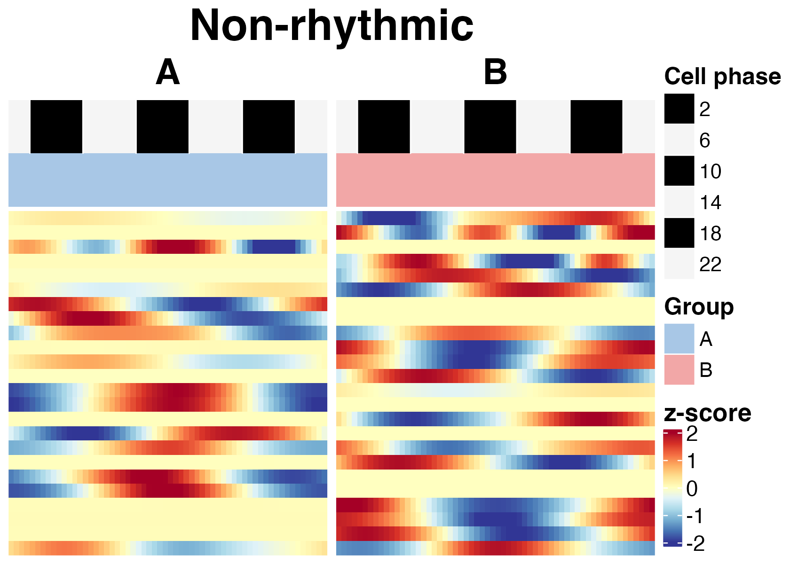
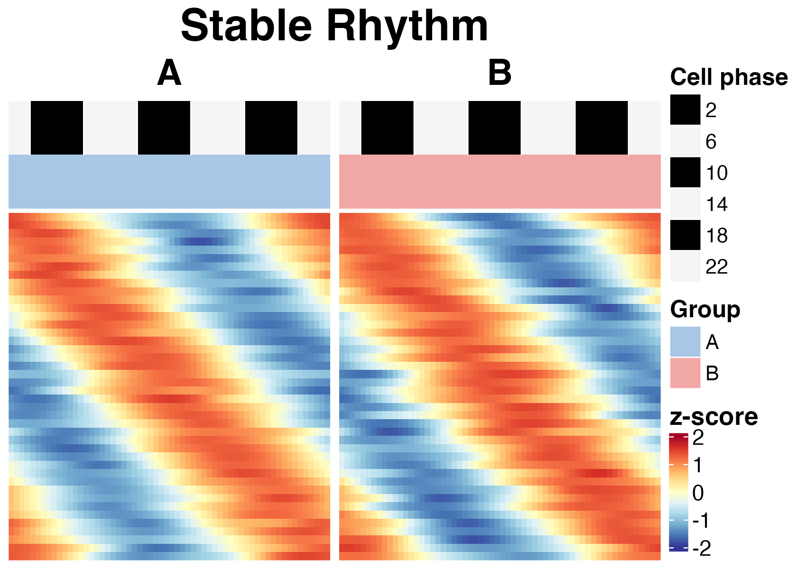
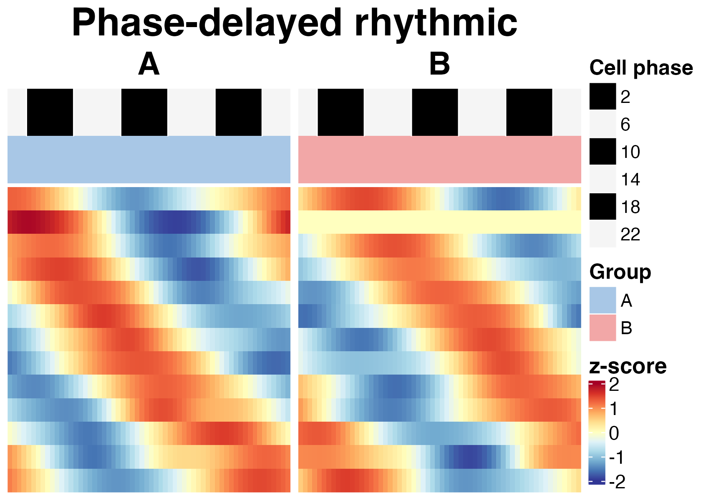
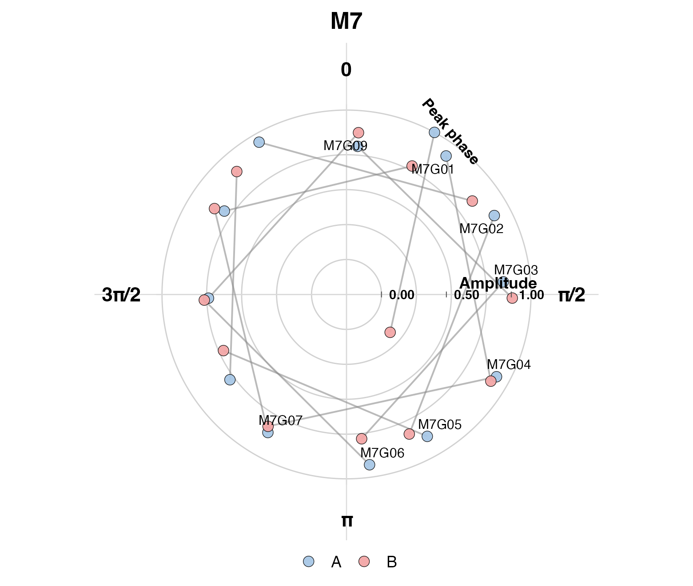

# Rhythm-state module analysis

## Overview

This tutorial describes the rhythm-state module branch of
`scRhythmBayes`.

The module branch is the main workflow for a **two-group rhythm-state
comparison within a defined biological context**. A typical use case is
condition `A` versus condition `B` within one selected cell type.

The workflow has five steps:

1.  infer cell-level circadian phase;
2.  select the biological context for comparison;
3.  estimate gene-level rhythmic parameters for the two groups;
4.  infer differential rhythm-state modules;
5.  visualize module-level remodeling using heatmaps and polar plots.

This tutorial focuses on the condition comparison within cell type `1`.
For direct cell-type comparisons or one-vs-rest discovery, see the basic
workflow and OVR tutorials.

## Load package and example data

``` r
library(scRhythmBayes)

data("srb_example_data")

count <- srb_example_data$Count
metadata <- srb_example_data$meta
```

``` r
dim(count)
#> NULL
head(metadata)
#>                        cell    sample replicate ZT celltype condition
#> Cell_0001_001 Cell_0001_001 A_ZT00_R1         1  0        1         A
#> Cell_0001_002 Cell_0001_002 A_ZT00_R1         1  0        1         A
#> Cell_0001_003 Cell_0001_003 A_ZT00_R1         1  0        1         A
#> Cell_0001_004 Cell_0001_004 A_ZT00_R1         1  0        1         A
#> Cell_0001_005 Cell_0001_005 A_ZT00_R1         1  0        1         A
#> Cell_0001_006 Cell_0001_006 A_ZT00_R1         1  0        1         A
#>                   T_true Theta_true Theta_noisy     r_sim
#> Cell_0001_001 23.7745644 6.22416640   6.0883578 0.7240322
#> Cell_0001_002 23.7111107 6.20755425   6.0324486 0.6303893
#> Cell_0001_003 22.2182691 5.81672924   5.8263271 0.8666633
#> Cell_0001_004  0.5581621 0.14612650   0.2245110 0.8593562
#> Cell_0001_005  0.7203817 0.18859549   0.3327113 0.6901345
#> Cell_0001_006  0.1788832 0.04683152   0.1722017 0.7564754
table(metadata$celltype, metadata$condition)
#>    
#>       A   B
#>   1 360 360
#>   2 360 360
#>   3 360 360
```

The required inputs are:

| Object | Description |
|----|----|
| `count` | Gene-by-cell count matrix |
| `metadata` | Cell-level metadata containing sampling time, cell type, and condition |
| `ZT` | Sampling Zeitgeber time column used for phase inference |
| `celltype` | Cell-type label used as the phase-inference stratum |
| `condition` | Two-group comparison variable for module analysis |
| `sample` | Independent biological sample for sample-aware testing |

## Step 1: infer cell-level circadian phase

The module workflow starts from inferred cell phases. These phases are
used as latent temporal coordinates for fitting gene-level rhythmic
parameters.

``` r
res_phase <- infer_cell_phase(
  count = count,
  metadata = metadata,
  ZT_by = "ZT",
  strata_by = "celltype",
  Species = "mouse",
  setseed = 1,
  Verbose = FALSE
)

head(res_phase)
#> # A tibble: 6 × 7
#>   cell          ZT_input stratum theta_pred ZT_pred  Rbar r_cell
#>   <chr>            <dbl> <chr>        <dbl>   <dbl> <dbl>  <dbl>
#> 1 Cell_0001_001        0 1            6.19   23.6   0.992  0.999
#> 2 Cell_0001_002        0 1            6.23   23.8   0.991  0.999
#> 3 Cell_0001_003        0 1            6.00   22.9   0.991  0.999
#> 4 Cell_0001_004        0 1            6.14   23.4   0.989  0.999
#> 5 Cell_0001_005        0 1            0.142   0.543 0.992  0.999
#> 6 Cell_0001_006        0 1            0.137   0.524 0.991  0.999
```

The output `res_phase` contains one row per cell.

| Column       | Description                                    |
|--------------|------------------------------------------------|
| `cell`       | Cell identifier                                |
| `ZT_input`   | Observed sampling Zeitgeber time               |
| `stratum`    | Stratum used during phase inference            |
| `theta_pred` | Inferred cell-level circadian phase in radians |
| `ZT_pred`    | Inferred phase converted to 24-hour time       |
| `Rbar`       | Aggregate phase concentration statistic        |
| `r_cell`     | Cell-level phase reliability weight            |

The two key columns for downstream modeling are `theta_pred` and
`r_cell`.

## Step 2: select one cell type for two-condition analysis

The recommended module-analysis design is to compare two groups within a
defined biological context. Here, we select cell type `1` and compare
condition `A` versus condition `B`.

``` r
cell_use <- as.character(metadata$celltype) == "1"

count_use <- count[, cell_use, drop = FALSE]
metadata_use <- metadata[cell_use, , drop = FALSE]
res_phase_use <- res_phase[cell_use, , drop = FALSE]

dim(count_use)
#> [1] 138 720
table(metadata_use$condition)
#> 
#>   A   B 
#> 360 360
```

This subset contains only cells from cell type `1`. The downstream model
estimates rhythmic parameters separately for condition `A` and condition
`B`.

## Step 3: estimate gene-level rhythmic parameters

### Input

The gene-level model requires the selected count matrix, selected
metadata, inferred cell phase, cell-level reliability weight, and a
grouping variable.

| Argument | Description |
|----|----|
| `count` | Gene-by-cell count matrix for the selected cell subset |
| `metadata` | Metadata for the same cells |
| `theta_pred` | Inferred cell phase from `res_phase` |
| `r_cell` | Cell-level phase reliability weight |
| `strata_by` | Grouping variable for gene-level parameter estimation, here `condition` |
| `sample_by` | Independent biological-sample column |
| `sample_boot_by` | Sample-bootstrap stratum, here ZT |

### Run gene-level parameter inference

``` r
res_param <- infer_gene_param(
  count = count_use,
  metadata = metadata_use,
  theta_pred = res_phase_use$theta_pred,
  r_cell = res_phase_use$r_cell,
  strata_by = "condition",
  ZT_by = "ZT",
  sample_by = "sample",
  sample_boot_by = "ZT",
  B = 3,
  n_worker = 1,
  setseed = 1,
  Verbose = FALSE
)

res_param$inference
#> $mode
#> [1] "restricted_null_cluster_multiplier_score"
#> 
#> $sample_by
#> [1] "sample"
#> 
#> $sample_boot_by
#> [1] "ZT"
#> 
#> $P_value
#> [1] "restricted-null biological-sample cluster multiplier score test with Rademacher weights"
#> 
#> $LRT
#> [1] "original cell-independence working-likelihood diagnostic only"
#> 
#> $CI
#> [1] "whole-sample pairs bootstrap for top 100 ranked genes only"
#> 
#> $fixed_inputs
#> [1] "theta_pred"   "r_cell"       "size_factors"
#> 
#> $sample_counts
#>  A  B 
#> 18 18 
#> 
#> $effect_size
#> [1] "joint MAP shrinkage may change only the added shrunk coefficient/amplitude columns; sample-aware P_value/FDR remain score-test based"
```

### Inspect output tables

``` r
head(res_param$param_long)
#>    gene condition    Mesor     Mean  Amplitude Amplitude_shrunk     Phase
#> 1 M0G01         A 1.755320 5.785298 0.01436746       0.01430728 2.8477570
#> 2 M0G02         A 1.921771 6.833052 0.13579497       0.13523794 0.8647751
#> 3 M0G03         A 2.204746 9.067948 0.11505040       0.11465868 3.6479931
#> 4 M0G04         A 1.426698 4.164923 0.07420760       0.07369124 5.1644391
#> 5 M0G05         A 1.539609 4.662766 0.16339559       0.16243396 1.3293299
#> 6 M0G06         A 1.902031 6.699489 0.08399906       0.08362891 4.5692592
#>        Alpha Dropout_rate P_value       FDR
#> 1 0.08455367    0.1359375  0.9685 0.9685000
#> 2 0.10384658    0.1192342  0.2306 0.2816177
#> 3 0.10989510    0.1215711  0.0990 0.1265000
#> 4 0.06151541    0.2681402  0.4694 0.5159667
#> 5 0.07776356    0.2308580  0.0808 0.1051925
#> 6 0.08152373    0.1846818  0.3260 0.3812542
```

``` r
head(res_param$param_wide)
#> # A tibble: 6 × 22
#>   gene  Mesor_A Mesor_B Mean_A Mean_B Amplitude_A Amplitude_B Amplitude_shrunk_A
#>   <chr>   <dbl>   <dbl>  <dbl>  <dbl>       <dbl>       <dbl>              <dbl>
#> 1 M0G01    1.76    1.78   5.79   5.93      0.0144     0.00395             0.0143
#> 2 M0G02    1.92    1.88   6.83   6.58      0.136      0.101               0.135 
#> 3 M0G03    2.20    2.23   9.07   9.31      0.115      0.0534              0.115 
#> 4 M0G04    1.43    1.49   4.16   4.43      0.0742     0.0876              0.0737
#> 5 M0G05    1.54    1.55   4.66   4.70      0.163      0.197               0.162 
#> 6 M0G06    1.90    1.87   6.70   6.49      0.0840     0.104               0.0836
#> # ℹ 14 more variables: Amplitude_shrunk_B <dbl>, Phase_A <dbl>, Phase_B <dbl>,
#> #   Alpha_A <dbl>, Alpha_B <dbl>, Dropout_rate_A <dbl>, Dropout_rate_B <dbl>,
#> #   FDR_A <dbl>, FDR_B <dbl>, Delta_Mesor <dbl>, Delta_Mean <dbl>,
#> #   Delta_Amp <dbl>, Delta_Amp_shrunk <dbl>, Delta_Phase <dbl>
```

The long-format table stores rhythmic parameters for each group. The
wide-format table is used for paired module comparison.

| Output | Description |
|----|----|
| `param_long` | Long-format gene-level rhythmic parameter estimates for each group |
| `param_wide` | Wide-format paired parameter table for downstream module analysis |
| `bootstrap_res` | Bootstrap results if available |

Common columns include:

| Column             | Meaning                                            |
|--------------------|----------------------------------------------------|
| `gene`             | Gene name                                          |
| `Mesor`            | Baseline rhythmic expression level                 |
| `Mean`             | Mean expression level                              |
| `Amplitude`        | Circadian oscillation amplitude                    |
| `Amplitude_shrunk` | Empirical-Bayes stabilized amplitude               |
| `Phase`            | Rhythmic phase in radians                          |
| `Alpha`            | Dispersion-related parameter                       |
| `Dropout_rate`     | Estimated dropout rate                             |
| `P_value`          | Rhythmicity P value from the active inference mode |
| `FDR`              | Adjusted rhythmicity significance                  |

## Step 4: infer differential rhythm-state modules

The module model compares rhythmic parameters between two groups and
assigns genes to interpretable rhythm-state remodeling classes.

``` r
res_module <- infer_rhythm_module(
  param_wide = res_param$param_wide,
  compare_by = "condition",
  group1 = "A",
  group2 = "B",
  out_dir = NULL,
  Verbose = FALSE
)

head(res_module$module_result)
#> # A tibble: 6 × 27
#>   gene  compare_by group1 group2 FDR_A  FDR_B Amplitude_A Amplitude_B Phase_A
#>   <chr> <chr>      <chr>  <chr>  <dbl>  <dbl>       <dbl>       <dbl>   <dbl>
#> 1 M0G01 condition  A      B      0.968 0.995           NA          NA      NA
#> 2 M0G02 condition  A      B      0.282 0.518           NA          NA      NA
#> 3 M0G03 condition  A      B      0.126 0.715           NA          NA      NA
#> 4 M0G04 condition  A      B      0.516 0.472           NA          NA      NA
#> 5 M0G05 condition  A      B      0.105 0.0661          NA          NA      NA
#> 6 M0G06 condition  A      B      0.381 0.0967          NA          NA      NA
#> # ℹ 18 more variables: Phase_B <dbl>, delta_phi_rad <dbl>, rA <dbl>, u <dbl>,
#> #   v <dbl>, seed_module <int>, module_map <int>, module_name <chr>,
#> #   post_M0 <dbl>, post_M1 <dbl>, post_M2 <dbl>, post_M3 <dbl>, post_M4 <dbl>,
#> #   post_M5 <dbl>, post_M6 <dbl>, post_M7 <dbl>, post_max <dbl>, margin <dbl>
```

``` r
table(res_module$module_result$module_name, useNA = "ifany")
#> 
#> Amplitude-attenuated rhythmic   Amplitude-enhanced rhythmic 
#>                            13                            12 
#>                  Non-rhythmic       Phase-advanced rhythmic 
#>                            24                            12 
#>        Phase-delayed rhythmic                   Rhythm Gain 
#>                            13                            12 
#>                   Rhythm Loss                 Stable Rhythm 
#>                            10                            42
```

The module result summarizes whether genes remain rhythmic, gain
rhythmicity, lose rhythmicity, shift phase, change amplitude, or show
other rhythm-state remodeling patterns.

Important output columns include:

| Column | Description |
|----|----|
| `gene` | Gene name |
| `compare_by` | Comparison variable |
| `group1`, `group2` | Compared groups |
| `FDR_A`, `FDR_B` | Rhythmicity FDR in each group |
| `Amplitude_A`, `Amplitude_B` | Rhythmic amplitude in each group |
| `Phase_A`, `Phase_B` | Rhythmic phase in each group |
| `delta_phi_rad` | Phase shift between groups in radians |
| `module_name` | Assigned rhythm-state remodeling module |
| `post_max` | Maximum posterior module probability |
| `margin` | Difference between top posterior probabilities |

## Step 5: visualize rhythm-state modules

### Build the module heatmap object

The module heatmap summarizes phase-ordered expression patterns for
genes assigned to rhythm-state modules.

``` r
hm_module <- plot_module_heatmap(
  count = count_use,
  res_phase = res_phase_use,
  gene_meta = res_module$module_result,
  metadata = metadata_use,
  group_by = "condition",
  group1 = "A",
  group2 = "B"
)

hm_module
#> scRhythmModuleHeatmap object
#>         module                   module_name n_gene_input n_gene_final
#> module0      0                  Non-rhythmic           24           24
#> module1      1                 Stable Rhythm           42           42
#> module2      2                   Rhythm Gain           12           12
#> module3      3                   Rhythm Loss           10           10
#> module4      4   Amplitude-enhanced rhythmic           12           12
#> module5      5 Amplitude-attenuated rhythmic           13           13
#> module6      6       Phase-advanced rhythmic           12           12
#> module7      7        Phase-delayed rhythmic           13           13
#>         ref_group status n_phase_ordered n_phase_missing
#> module0         A     ok               0              24
#> module1         A     ok              42               0
#> module2         B     ok              12               0
#> module3         A     ok              10               0
#> module4         B     ok              12               0
#> module5         A     ok              13               0
#> module6         A     ok              12               0
#> module7         A     ok              13               0
```

### Plot selected module heatmaps

The following plots display selected module IDs. This keeps the tutorial
compact while still showing the heatmap output format.

``` r
plot(hm_module, module_id = 0)
```



``` r
plot(hm_module, module_id = 1)
```



``` r
plot(hm_module, module_id = 7)
```



The heatmap shows expression patterns ordered by inferred cell phase and
separated by condition. It is useful for checking whether genes assigned
to a module show coherent phase-resolved expression patterns across the
compared groups.

### Optional: plot all eight module heatmaps

If a complete visual inspection is needed, all eight module IDs can be
plotted.

``` r
plot(hm_module, module_id = 0)
plot(hm_module, module_id = 1)
plot(hm_module, module_id = 2)
plot(hm_module, module_id = 3)
plot(hm_module, module_id = 4)
plot(hm_module, module_id = 5)
plot(hm_module, module_id = 6)
plot(hm_module, module_id = 7)
```

Keeping the full set as `eval = FALSE` can reduce vignette build time
and avoid generating an overly long article page. If the goal is a fully
visual GitHub Pages tutorial, these lines can be split into separate
evaluated chunks.

## Step 6: plot rhythm remodeling in polar space

The polar plot displays rhythmic remodeling in amplitude-phase space.
Phase is represented by angular position and amplitude by radial
distance.

``` r
p_polar <- plot_module_polar(
  gene_meta = res_module$module_result,
  module_id = 7,
  group1 = "A",
  group2 = "B"
)

p_polar$plot
```



This plot is useful for inspecting how genes in a selected module are
distributed by rhythmic amplitude and phase.

## Recommended minimal workflow

``` r
data("srb_example_data")

count <- srb_example_data$Count
metadata <- srb_example_data$meta

res_phase <- infer_cell_phase(
  count = count,
  metadata = metadata,
  ZT_by = "ZT",
  strata_by = "celltype",
  Species = "mouse",
  setseed = 1,
  Verbose = FALSE
)

cell_use <- as.character(metadata$celltype) == "1"

count_use <- count[, cell_use, drop = FALSE]
metadata_use <- metadata[cell_use, , drop = FALSE]
res_phase_use <- res_phase[cell_use, , drop = FALSE]

res_param <- infer_gene_param(
  count = count_use,
  metadata = metadata_use,
  theta_pred = res_phase_use$theta_pred,
  r_cell = res_phase_use$r_cell,
  strata_by = "condition",
  ZT_by = "ZT",
  sample_by = "sample",
  sample_boot_by = "ZT",
  B = 3,
  n_worker = 1,
  setseed = 1,
  Verbose = FALSE
)

res_module <- infer_rhythm_module(
  param_wide = res_param$param_wide,
  compare_by = "condition",
  group1 = "A",
  group2 = "B",
  out_dir = NULL,
  Verbose = FALSE
)

hm_module <- plot_module_heatmap(
  count = count_use,
  res_phase = res_phase_use,
  gene_meta = res_module$module_result,
  metadata = metadata_use,
  group_by = "condition",
  group1 = "A",
  group2 = "B"
)

plot(hm_module, module_id = 0)
```

## Notes for real datasets

For real datasets, the module branch should be used when the comparison
is clearly defined as two groups within a biological context.

Typical designs include:

| Biological question | Suggested setup |
|----|----|
| Disease versus control within one cell type | Subset one cell type and set `strata_by = "condition"` |
| Treatment versus baseline within one cell type | Subset one cell type and set `strata_by = "condition"` |
| Region A versus region B within one cell type | Subset one cell type and set `strata_by` to the region column |
| Two selected cell types | Estimate parameters by `celltype`, then compare two selected labels |

For broad cell-type-specific discovery across many cell types, the OVR
workflow is usually more appropriate than repeatedly running pairwise
module comparisons.

## Session information

``` r
sessionInfo()
#> R version 4.5.1 (2025-06-13)
#> Platform: aarch64-apple-darwin20
#> Running under: macOS Sequoia 15.5
#> 
#> Matrix products: default
#> BLAS:   /Library/Frameworks/R.framework/Versions/4.5-arm64/Resources/lib/libRblas.0.dylib 
#> LAPACK: /Library/Frameworks/R.framework/Versions/4.5-arm64/Resources/lib/libRlapack.dylib;  LAPACK version 3.12.1
#> 
#> locale:
#> [1] C.UTF-8/C.UTF-8/C.UTF-8/C/C.UTF-8/C.UTF-8
#> 
#> time zone: Asia/Shanghai
#> tzcode source: internal
#> 
#> attached base packages:
#> [1] stats     graphics  grDevices utils     datasets  methods   base     
#> 
#> other attached packages:
#> [1] tidyr_1.3.2         tibble_3.3.1        dplyr_1.2.1        
#> [4] Matrix_1.7-5        purrr_1.2.2         future_1.70.0      
#> [7] scRhythmBayes_0.1.0
#> 
#> loaded via a namespace (and not attached):
#>   [1] RColorBrewer_1.1-3     shape_1.4.6.1          jsonlite_2.0.0        
#>   [4] magrittr_2.0.5         spatstat.utils_3.2-2   farver_2.1.2          
#>   [7] rmarkdown_2.31         GlobalOptions_0.1.4    fs_2.0.1              
#>  [10] ragg_1.5.2             vctrs_0.7.3            ROCR_1.0-12           
#>  [13] Cairo_1.7-0            spatstat.explore_3.8-0 htmltools_0.5.9       
#>  [16] sass_0.4.10            sctransform_0.4.3      parallelly_1.46.1     
#>  [19] KernSmooth_2.23-26     bslib_0.10.0           htmlwidgets_1.6.4     
#>  [22] desc_1.4.3             ica_1.0-3              plyr_1.8.9            
#>  [25] plotly_4.12.0          zoo_1.8-15             cachem_1.1.0          
#>  [28] igraph_2.2.3           iterators_1.0.14       mime_0.13             
#>  [31] lifecycle_1.0.5        pkgconfig_2.0.3        R6_2.6.1              
#>  [34] fastmap_1.2.0          clue_0.3-68            fitdistrplus_1.2-6    
#>  [37] shiny_1.13.0           digest_0.6.39          colorspace_2.1-2      
#>  [40] furrr_0.4.0            S4Vectors_0.46.0       patchwork_1.3.2       
#>  [43] Seurat_5.4.0           tensor_1.5.1           RSpectra_0.16-2       
#>  [46] irlba_2.3.7            textshaping_1.0.5      labeling_0.4.3        
#>  [49] progressr_0.19.0       spatstat.sparse_3.1-0  httr_1.4.8            
#>  [52] polyclip_1.10-7        abind_1.4-8            mgcv_1.9-4            
#>  [55] compiler_4.5.1         withr_3.0.2            doParallel_1.0.17     
#>  [58] S7_0.2.1               fastDummies_1.7.5      MASS_7.3-65           
#>  [61] rjson_0.2.23           tools_4.5.1            lmtest_0.9-40         
#>  [64] otel_0.2.0             httpuv_1.6.17          future.apply_1.20.2   
#>  [67] goftest_1.2-3          glue_1.8.0             nlme_3.1-169          
#>  [70] promises_1.5.0         grid_4.5.1             Rtsne_0.17            
#>  [73] cluster_2.1.8.2        reshape2_1.4.5         generics_0.1.4        
#>  [76] gtable_0.3.6           spatstat.data_3.1-9    data.table_1.18.2.1   
#>  [79] sp_2.2-1               utf8_1.2.6             BiocGenerics_0.54.1   
#>  [82] spatstat.geom_3.7-3    RcppAnnoy_0.0.23       ggrepel_0.9.8         
#>  [85] RANN_2.6.2             foreach_1.5.2          pillar_1.11.1         
#>  [88] stringr_1.6.0          spam_2.11-3            RcppHNSW_0.6.0        
#>  [91] later_1.4.8            circlize_0.4.18        splines_4.5.1         
#>  [94] lattice_0.22-9         survival_3.8-6         deldir_2.0-4          
#>  [97] tidyselect_1.2.1       ComplexHeatmap_2.24.1  miniUI_0.1.2          
#> [100] pbapply_1.7-4          knitr_1.51             gridExtra_2.3         
#> [103] IRanges_2.42.0         scattermore_1.2        stats4_4.5.1          
#> [106] xfun_0.57              matrixStats_1.5.0      stringi_1.8.7         
#> [109] lazyeval_0.2.3         yaml_2.3.12            evaluate_1.0.5        
#> [112] codetools_0.2-20       cli_3.6.6              uwot_0.2.4            
#> [115] xtable_1.8-8           reticulate_1.46.0      systemfonts_1.3.2     
#> [118] jquerylib_0.1.4        dichromat_2.0-0.1      Rcpp_1.1.1            
#> [121] globals_0.19.1         spatstat.random_3.4-5  png_0.1-9             
#> [124] spatstat.univar_3.1-7  parallel_4.5.1         pkgdown_2.2.0         
#> [127] ggplot2_4.0.2          dotCall64_1.2          listenv_0.10.1        
#> [130] viridisLite_0.4.3      mvtnorm_1.3-6          scales_1.4.0          
#> [133] ggridges_0.5.7         crayon_1.5.3           SeuratObject_5.4.0    
#> [136] GetoptLong_1.1.1       rlang_1.2.0            cowplot_1.2.0
```
