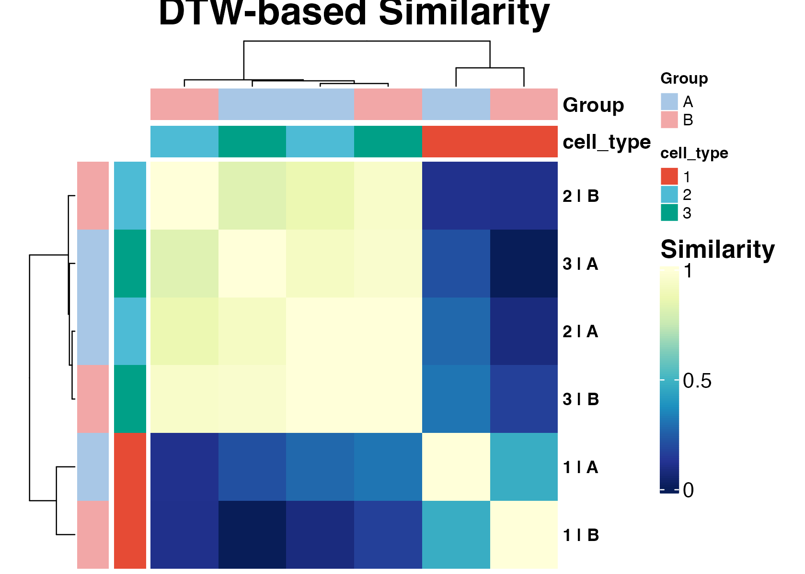
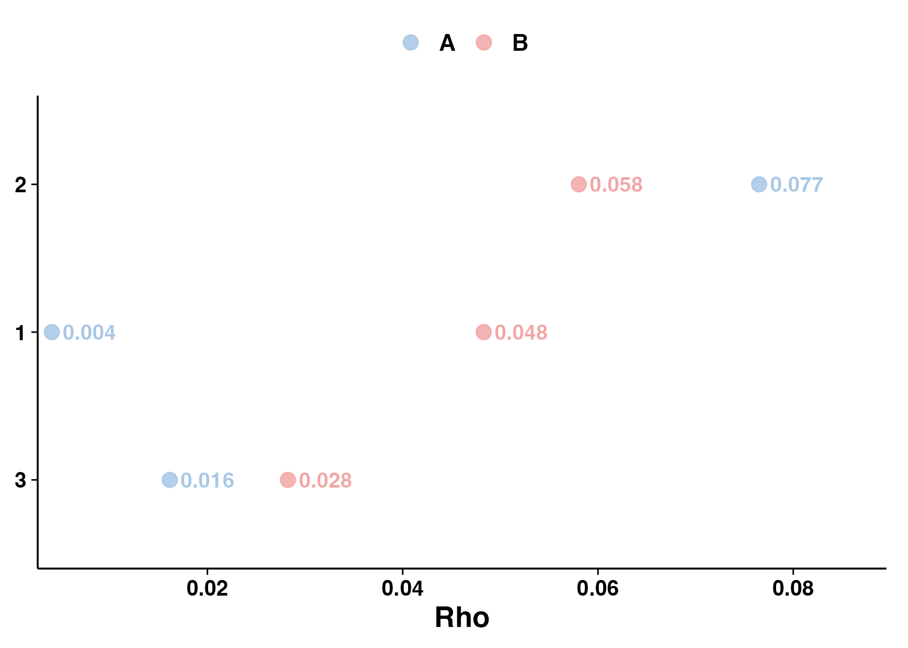
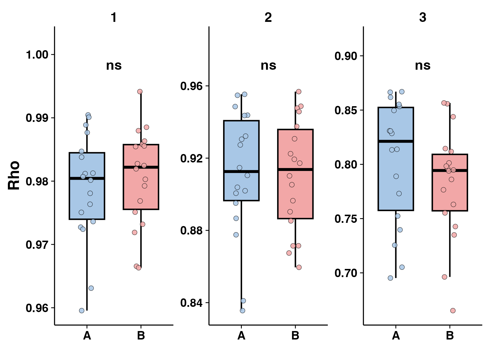

# DTW and rho phase-prioritization analysis

## Overview

This tutorial describes two phase-level extension analyses in
`scRhythmBayes`:

1.  **DTW-based phase-distribution similarity**
2.  **Circular phase-concentration rho analysis**

These analyses are useful for prioritizing cell types, conditions, or
celltype-by-condition combinations that show differences in inferred
circadian phase distributions.

Unlike rhythm-state module analysis or one-vs-rest rhythmic program
discovery, DTW and rho analyses operate mainly at the **cell-phase
level**. They use the inferred cell-level phase result and cell-level
metadata, rather than gene-level parameter tables.

The typical use case is:

1.  infer cell-level circadian phase;
2.  compare phase distributions across cell types and groups;
3.  prioritize cell types or conditions with strong phase-distribution
    remodeling;
4.  perform downstream gene-level rhythm-state analysis on selected
    biological contexts.

## Load package and example data

``` r
library(scRhythmBayes)

data("srb_example_data")

count <- srb_example_data$Count
metadata <- srb_example_data$meta
```

``` r
dim(count)
#> NULL
head(metadata)
#>                        cell    sample replicate ZT celltype condition
#> Cell_0001_001 Cell_0001_001 A_ZT00_R1         1  0        1         A
#> Cell_0001_002 Cell_0001_002 A_ZT00_R1         1  0        1         A
#> Cell_0001_003 Cell_0001_003 A_ZT00_R1         1  0        1         A
#> Cell_0001_004 Cell_0001_004 A_ZT00_R1         1  0        1         A
#> Cell_0001_005 Cell_0001_005 A_ZT00_R1         1  0        1         A
#> Cell_0001_006 Cell_0001_006 A_ZT00_R1         1  0        1         A
#>                   T_true Theta_true Theta_noisy     r_sim
#> Cell_0001_001 23.7745644 6.22416640   6.0883578 0.7240322
#> Cell_0001_002 23.7111107 6.20755425   6.0324486 0.6303893
#> Cell_0001_003 22.2182691 5.81672924   5.8263271 0.8666633
#> Cell_0001_004  0.5581621 0.14612650   0.2245110 0.8593562
#> Cell_0001_005  0.7203817 0.18859549   0.3327113 0.6901345
#> Cell_0001_006  0.1788832 0.04683152   0.1722017 0.7564754
table(metadata$celltype, metadata$condition)
#>    
#>       A   B
#>   1 360 360
#>   2 360 360
#>   3 360 360
```

The example dataset contains:

| Object | Description |
|----|----|
| `count` | Gene-by-cell sparse count matrix |
| `metadata` | Cell-level metadata containing sampling time, cell type, condition, and simulated true phase |

The key metadata columns used in this tutorial are:

| Column | Description |
|----|----|
| `cell` | Cell identifier |
| `sample` | Independent biological sample |
| `replicate` | Replicate within condition and ZT |
| `ZT` | Sampling Zeitgeber time |
| `celltype` | Cell-type label |
| `condition` | Group or condition label |
| `T_true` | Simulated true circadian time in hours |
| `Theta_true` | Simulated true circadian phase in radians |
| `Theta_noisy`, `r_sim` | Simulated noisy phase truth retained for validation |

## Step 1: infer cell-level circadian phase

Both DTW and rho analyses start from the inferred cell-level circadian
phase.

``` r
res_phase <- infer_cell_phase(
  count = count,
  metadata = metadata,
  ZT_by = "ZT",
  strata_by = "celltype",
  Species = "mouse",
  setseed = 1,
  Verbose = FALSE
)

head(res_phase)
#> # A tibble: 6 × 7
#>   cell          ZT_input stratum theta_pred ZT_pred  Rbar r_cell
#>   <chr>            <dbl> <chr>        <dbl>   <dbl> <dbl>  <dbl>
#> 1 Cell_0001_001        0 1            6.19   23.6   0.992  0.999
#> 2 Cell_0001_002        0 1            6.23   23.8   0.991  0.999
#> 3 Cell_0001_003        0 1            6.00   22.9   0.991  0.999
#> 4 Cell_0001_004        0 1            6.14   23.4   0.989  0.999
#> 5 Cell_0001_005        0 1            0.142   0.543 0.992  0.999
#> 6 Cell_0001_006        0 1            0.137   0.524 0.991  0.999
```

The main columns used by downstream phase-prioritization analyses are:

| Column       | Description                                    |
|--------------|------------------------------------------------|
| `cell`       | Cell identifier                                |
| `theta_pred` | Inferred cell-level circadian phase in radians |
| `ZT_pred`    | Inferred phase converted to 24-hour time       |
| `r_cell`     | Cell-level phase reliability weight            |

## Analysis design

The phase-prioritization branch can be used in several common settings.

| Analysis goal | Function | Main grouping variables | Main output |
|----|----|----|----|
| Compare full phase-distribution shapes | [`run_dtw_similarity()`](https://liwei-dynamicslab.github.io/scRhythmBayes/reference/run_dtw_similarity.md) | `celltype_by`, `group_by` | DTW distance and similarity matrices |
| Summarize phase concentration by group | [`run_phase_rho()`](https://liwei-dynamicslab.github.io/scRhythmBayes/reference/run_phase_rho.md) | `celltype_by`, `group_by` | Group-level rho summary |
| Compare sample-level phase concentration | [`run_phase_rho()`](https://liwei-dynamicslab.github.io/scRhythmBayes/reference/run_phase_rho.md) with `sample_by` | `celltype_by`, `group_by`, `sample_by` | Sample-level rho table and group comparison |

DTW is useful when the question is whether two phase distributions have
similar shapes. Rho is useful when the question is whether cells within
a cell type or group are concentrated around a phase or broadly
dispersed.

## Part I: DTW-based phase-distribution similarity

### Input

The DTW analysis requires:

| Argument | Description |
|----|----|
| `res_phase` | Cell-level phase inference result from [`infer_cell_phase()`](https://liwei-dynamicslab.github.io/scRhythmBayes/reference/infer_cell_phase.md) |
| `metadata` | Cell-level metadata |
| `celltype_by` | Metadata column defining cell type or biological compartment |
| `group_by` | Metadata column defining condition or group |
| `min_cell` | Minimum number of cells required for each celltype-by-group combination |

The function constructs circular phase histograms for each
celltype-by-group combination and compares these histograms using
dynamic time warping.

### Run DTW similarity analysis

``` r
dtw_res <- run_dtw_similarity(
  res_phase = res_phase,
  metadata = metadata,
  celltype_by = "celltype",
  group_by = "condition",
  min_cell = 10,
  Verbose = FALSE
)

dtw_res
#> scRhythmDTWSimilarity object
#> Combinations: 6 
#> Bins: 24 
#> Groups: A, B 
#> Cell types: 1, 2, 3 
#> 
#>   cell_type Group n_cell combo
#> 1         1     A    360 1 | A
#> 4         1     B    360 1 | B
#> 2         2     A    360 2 | A
#> 5         2     B    360 2 | B
#> 3         3     A    360 3 | A
#> 6         3     B    360 3 | B
```

### Inspect circular phase histograms

``` r
head(dtw_res$histogram)
#>   combo cell_type Group bin bin_start   bin_end   bin_mid       prop
#> 1 1 | A         1     A   1 0.0000000 0.2617994 0.1308997 0.05833333
#> 2 1 | A         1     A   2 0.2617994 0.5235988 0.3926991 0.02222222
#> 3 1 | A         1     A   3 0.5235988 0.7853982 0.6544985 0.01666667
#> 4 1 | A         1     A   4 0.7853982 1.0471976 0.9162979 0.06388889
#> 5 1 | A         1     A   5 1.0471976 1.3089969 1.1780972 0.07500000
#> 6 1 | A         1     A   6 1.3089969 1.5707963 1.4398966 0.01111111
```

The histogram table contains binned circular phase distributions for
each celltype-by-condition combination.

| Column                 | Description                          |
|------------------------|--------------------------------------|
| `combo`                | Combined celltype-by-group label     |
| `cell_type`            | Cell-type label                      |
| `Group`                | Group or condition label             |
| `bin`                  | Circular phase bin index             |
| `bin_start`, `bin_end` | Phase-bin boundaries in radians      |
| `bin_mid`              | Phase-bin midpoint                   |
| `prop`                 | Proportion of cells in the phase bin |

### Inspect DTW similarity matrix

``` r
dtw_res$similarity
#>           1 | A     1 | B     2 | A     2 | B     3 | A     3 | B
#> 1 | A 1.0000000 0.4730539 0.2743924 0.1117194 0.2089335 0.3072317
#> 1 | B 0.4730539 1.0000000 0.0807574 0.1062086 0.0000000 0.1623240
#> 2 | A 0.2743924 0.0807574 1.0000000 0.8754491 0.9337795 1.0000000
#> 2 | B 0.1117194 0.1062086 0.8754491 1.0000000 0.8323353 0.9520958
#> 3 | A 0.2089335 0.0000000 0.9337795 0.8323353 1.0000000 0.9628112
#> 3 | B 0.3072317 0.1623240 1.0000000 0.9520958 0.9628112 1.0000000
```

The result object contains:

| Output | Meaning |
|----|----|
| `data` | Merged cell-level phase and metadata table |
| `histogram` | Circular phase histogram for each celltype-by-group combination |
| `distance` | Pairwise DTW distance matrix |
| `similarity` | Scaled 0-to-1 DTW similarity matrix |
| `annotation` | Annotation table for heatmap rows and columns |

A higher similarity value indicates a more similar inferred
phase-distribution profile. A lower similarity value indicates a
stronger phase-distribution difference.

### Plot DTW heatmap

``` r
ht_dtw <- plot_dtw_heatmap(
  dtw_res = dtw_res
)

ht_dtw
#> scRhythmDTWHeatmap object
#> Matrix type: similarity 
#> Matrix dimension: 6 x 6
plot(ht_dtw)
```



The DTW heatmap provides a compact overview of phase-distribution
similarity across celltype-by-condition combinations.

## Part II: circular phase-concentration rho analysis

### Concept

The rho analysis summarizes the concentration of inferred cell phases.
Larger rho indicates that cells are more concentrated around a common
phase. Smaller rho indicates a more dispersed phase distribution.

This analysis is useful for identifying cell types or conditions with
strong phase alignment or phase dispersion.

### Input

The group-level rho analysis requires:

| Argument | Description |
|----|----|
| `res_phase` | Cell-level phase inference result |
| `metadata` | Cell-level metadata |
| `celltype_by` | Metadata column defining cell type |
| `group_by` | Metadata column defining condition or group |
| `theta_by` | Column in `res_phase` containing inferred phase in radians |
| `group_levels` | Optional display or comparison order for groups |
| `min_cell` | Minimum number of cells required per celltype-by-group combination |

### Run group-level rho analysis

``` r
rho_res <- run_phase_rho(
  res_phase = res_phase,
  metadata = metadata,
  celltype_by = "celltype",
  group_by = "condition",
  theta_by = "theta_pred",
  group_levels = c("A", "B"),
  min_cell = 10,
  Verbose = FALSE
)

rho_res
#> scRhythmPhaseRho object
#> 
#> Group-level rho:
#>   cell_type Group n_cell         rho mean_phase_rad mean_phase_hour   rho_mean
#> 1         1     A    360 0.004067866     5.66087818       21.622962 0.02618392
#> 2         1     B    360 0.048299964     0.07905898        0.301983 0.02618392
#> 3         2     A    360 0.076505117     3.80882367       14.548635 0.06727230
#> 4         2     B    360 0.058039490     3.05496773       11.669117 0.06727230
#> 5         3     A    360 0.016142579     1.57051585        5.998929 0.02219223
#> 6         3     B    360 0.028241886     5.51204730       21.054470 0.02219223
#> 
#> Sample-level group comparison: not available
```

### Inspect group-level rho table

``` r
rho_res$rho_group
#> NULL
```

The group-level rho table contains:

| Column            | Description                                   |
|-------------------|-----------------------------------------------|
| `cell_type`       | Cell-type label                               |
| `Group`           | Group or condition label                      |
| `n_cell`          | Number of cells used                          |
| `rho`             | Circular phase concentration statistic        |
| `mean_phase_rad`  | Mean circular phase in radians                |
| `mean_phase_hour` | Mean circular phase converted to 24-hour time |

### Plot group-level rho

``` r
p_rho <- plot_phase_rho(rho_res)

p_rho$plot
```



The plot summarizes phase concentration across cell types and groups.

## Part III: sample-level rho analysis

Sample-level rho analysis is useful when the dataset contains biological
sample IDs, replicate IDs, patient IDs, animal IDs, or other
sample-level units.

The example data contain 36 sample IDs assigned during simulation. They
are independent experimental units, not labels randomly added to cells.

``` r
sample_design <- unique(
  metadata[c("sample", "condition", "ZT", "replicate")]
)

nrow(sample_design)
#> [1] 36
with(sample_design, table(condition, ZT))
#>          ZT
#> condition 0 4 8 12 16 20
#>         A 3 3 3  3  3  3
#>         B 3 3 3  3  3  3
```

### Run sample-level rho analysis

``` r
rho_res_sample <- run_phase_rho(
  res_phase = res_phase,
  metadata = metadata,
  celltype_by = "celltype",
  group_by = "condition",
  sample_by = "sample",
  theta_by = "theta_pred",
  group_levels = c("A", "B"),
  compare_groups = c("A", "B"),
  min_cell = 10,
  Verbose = FALSE
)

head(rho_res_sample$rho_sample)
#>   cell_type Group    Sample n_cell       rho mean_phase_rad mean_phase_hour
#> 1         1     A A_ZT00_R1     20 0.9812679    0.007222493      0.02758789
#> 2         1     A A_ZT00_R2     20 0.9727272    6.261130650     23.91575741
#> 3         1     A A_ZT00_R3     20 0.9724092    0.065011902      0.24832717
#> 4         1     A A_ZT04_R1     20 0.9904582    1.116099149      4.26318472
#> 5         1     A A_ZT04_R2     20 0.9595515    1.022346888      3.90507746
#> 6         1     A A_ZT04_R3     20 0.9838027    0.999653055      3.81839340
```

The sample-level rho table contains one row per
celltype-by-group-by-sample unit.

| Column            | Description                                   |
|-------------------|-----------------------------------------------|
| `cell_type`       | Cell-type label                               |
| `Group`           | Group or condition label                      |
| `Sample`          | Sample identifier                             |
| `n_cell`          | Number of cells in the sample-level unit      |
| `rho`             | Sample-level circular phase concentration     |
| `mean_phase_rad`  | Mean circular phase in radians                |
| `mean_phase_hour` | Mean circular phase converted to 24-hour time |

### Plot sample-level rho

``` r
p_rho_sample <- plot_phase_rho(rho_res_sample)

p_rho_sample$plot
```



The sample-level plot and statistical comparison use sample-level rho
values. This distinguishes biological-sample variation from the number
of cells observed within each sample.

## Recommended minimal workflow

``` r
dtw_res <- run_dtw_similarity(
  res_phase = res_phase,
  metadata = metadata,
  celltype_by = "celltype",
  group_by = "condition",
  min_cell = 10,
  Verbose = FALSE
)

ht_dtw <- plot_dtw_heatmap(dtw_res = dtw_res)
plot(ht_dtw)

rho_res <- run_phase_rho(
  res_phase = res_phase,
  metadata = metadata,
  celltype_by = "celltype",
  group_by = "condition",
  theta_by = "theta_pred",
  group_levels = c("A", "B"),
  min_cell = 10,
  Verbose = FALSE
)

p_rho <- plot_phase_rho(rho_res)
p_rho$plot
```

## Output summary

| Object | Description |
|----|----|
| `dtw_res` | DTW-based phase-distribution similarity result |
| `dtw_res$histogram` | Circular phase histograms by celltype-by-group combination |
| `dtw_res$distance` | Pairwise DTW distance matrix |
| `dtw_res$similarity` | Scaled DTW similarity matrix |
| `rho_res` | Group-level circular phase-concentration result |
| `rho_res$rho_group` | Group-level rho summary |
| `rho_res_sample` | Sample-level circular phase-concentration result |
| `rho_res_sample$rho_sample` | Sample-level rho summary |

## Notes for real datasets

For real datasets, users should choose grouping variables based on the
biological question.

Use DTW analysis when the main question is:

- Which cell types or conditions have similar inferred phase
  distributions?
- Which celltype-by-condition combinations show phase-distribution
  remodeling?
- Which biological contexts should be prioritized for downstream
  rhythm-state module analysis?

Use rho analysis when the main question is:

- Are cells in a given cell type or condition phase-concentrated?
- Does phase concentration differ between conditions?
- Is phase concentration consistent across biological samples?

For sample-level rho analysis, `sample_by` should correspond to real
biological replicate structure, such as animal ID, patient ID, donor ID,
or sample ID.

## Session information

``` r
sessionInfo()
#> R version 4.5.1 (2025-06-13)
#> Platform: aarch64-apple-darwin20
#> Running under: macOS Sequoia 15.5
#> 
#> Matrix products: default
#> BLAS:   /Library/Frameworks/R.framework/Versions/4.5-arm64/Resources/lib/libRblas.0.dylib 
#> LAPACK: /Library/Frameworks/R.framework/Versions/4.5-arm64/Resources/lib/libRlapack.dylib;  LAPACK version 3.12.1
#> 
#> locale:
#> [1] C.UTF-8/C.UTF-8/C.UTF-8/C/C.UTF-8/C.UTF-8
#> 
#> time zone: Asia/Shanghai
#> tzcode source: internal
#> 
#> attached base packages:
#> [1] stats     graphics  grDevices utils     datasets  methods   base     
#> 
#> other attached packages:
#> [1] scRhythmBayes_0.1.0
#> 
#> loaded via a namespace (and not attached):
#>  [1] gtable_0.3.6          circlize_0.4.18       shape_1.4.6.1        
#>  [4] rjson_0.2.23          xfun_0.57             bslib_0.10.0         
#>  [7] ggplot2_4.0.2         htmlwidgets_1.6.4     GlobalOptions_0.1.4  
#> [10] ggrepel_0.9.8         lattice_0.22-9        Cairo_1.7-0          
#> [13] vctrs_0.7.3           tools_4.5.1           generics_0.1.4       
#> [16] stats4_4.5.1          parallel_4.5.1        tibble_3.3.1         
#> [19] proxy_0.4-29          cluster_2.1.8.2       pkgconfig_2.0.3      
#> [22] Matrix_1.7-5          RColorBrewer_1.1-3    S7_0.2.1             
#> [25] desc_1.4.3            S4Vectors_0.46.0      lifecycle_1.0.5      
#> [28] circular_0.5-2        compiler_4.5.1        farver_2.1.2         
#> [31] textshaping_1.0.5     codetools_0.2-20      ComplexHeatmap_2.24.1
#> [34] clue_0.3-68           htmltools_0.5.9       sass_0.4.10          
#> [37] yaml_2.3.12           pillar_1.11.1         pkgdown_2.2.0        
#> [40] crayon_1.5.3          jquerylib_0.1.4       MASS_7.3-65          
#> [43] cachem_1.1.0          iterators_1.0.14      boot_1.3-32          
#> [46] foreach_1.5.2         tidyselect_1.2.1      digest_0.6.39        
#> [49] mvtnorm_1.3-6         dplyr_1.2.1           labeling_0.4.3       
#> [52] fastmap_1.2.0         grid_4.5.1            colorspace_2.1-2     
#> [55] cli_3.6.6             magrittr_2.0.5        dichromat_2.0-0.1    
#> [58] utf8_1.2.6            withr_3.0.2           scales_1.4.0         
#> [61] rmarkdown_2.31        matrixStats_1.5.0     otel_0.2.0           
#> [64] ragg_1.5.2            png_0.1-9             GetoptLong_1.1.1     
#> [67] evaluate_1.0.5        knitr_1.51            IRanges_2.42.0       
#> [70] dtw_1.23-3            doParallel_1.0.17     rlang_1.2.0          
#> [73] Rcpp_1.1.1            glue_1.8.0            BiocGenerics_0.54.1  
#> [76] jsonlite_2.0.0        R6_2.6.1              systemfonts_1.3.2    
#> [79] fs_2.0.1
```
