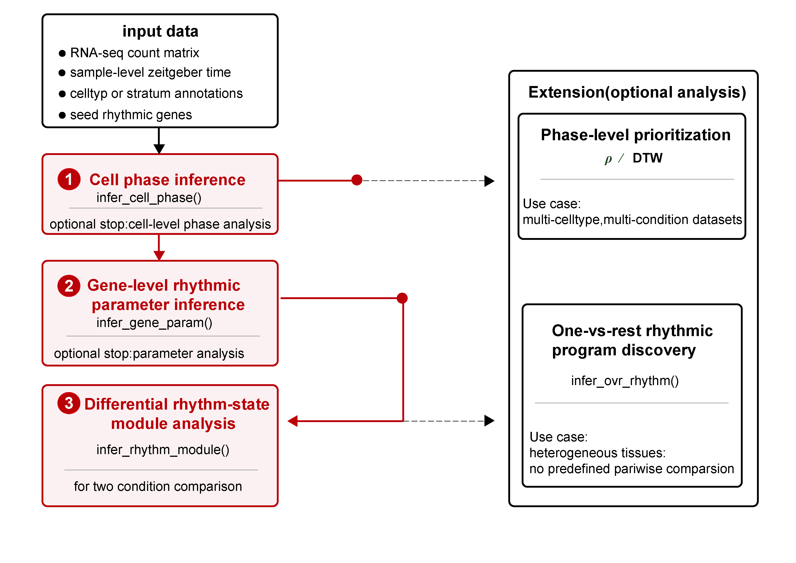

# scRhythmBayes

[](https://github.com/Liwei-DynamicsLab/scRhythmBayes/actions/workflows/R-CMD-check.yaml)
[](https://github.com/Liwei-DynamicsLab/scRhythmBayes/actions/workflows/pkgdown.yaml)

**Cell-level circadian phase inference and rhythm-state remodeling for
single-cell transcriptomes**

`scRhythmBayes` infers latent cell-level circadian phase, estimates
sample-aware gene rhythmicity, classifies differential rhythm states,
and supports one-vs-rest and phase-distribution analyses.



## Overview

| Analysis | Main function |
|----|----|
| Cell-level circadian phase | [`infer_cell_phase()`](https://liwei-dynamicslab.github.io/scRhythmBayes/reference/infer_cell_phase.md) |
| Gene-level rhythmic parameters | [`infer_gene_param()`](https://liwei-dynamicslab.github.io/scRhythmBayes/reference/infer_gene_param.md) |
| M0–M7 rhythm-state modules | [`infer_rhythm_module()`](https://liwei-dynamicslab.github.io/scRhythmBayes/reference/infer_rhythm_module.md) |
| One-vs-rest rhythmic programs | [`infer_ovr_rhythm()`](https://liwei-dynamicslab.github.io/scRhythmBayes/reference/infer_ovr_rhythm.md) |
| Phase-distribution similarity | [`run_dtw_similarity()`](https://liwei-dynamicslab.github.io/scRhythmBayes/reference/run_dtw_similarity.md) |
| Circular phase concentration | [`run_phase_rho()`](https://liwei-dynamicslab.github.io/scRhythmBayes/reference/run_phase_rho.md) |

## Installation

``` r
install.packages("remotes")
remotes::install_github("Liwei-DynamicsLab/scRhythmBayes")
```

``` r
library(scRhythmBayes)
```

## Example data

The bundled teaching dataset contains 138 genes, 2,160 cells, and 36
independent samples from two conditions, six ZT values, and three
biological replicates.

``` r
data("srb_example_data")

count <- srb_example_data$Count
metadata <- srb_example_data$meta

dim(count)
head(metadata)
```

The count matrix and metadata are aligned by cell ID:

``` r
stopifnot(identical(colnames(count), metadata$cell))

sample_design <- unique(
  metadata[c("sample", "condition", "ZT", "replicate")]
)

nrow(sample_design)
with(sample_design, table(condition, ZT))
```

## Core workflow

### 1. Infer cell-level circadian phase

``` r
res_phase <- infer_cell_phase(
  count = count,
  metadata = metadata,
  ZT_by = "ZT",
  strata_by = "celltype",
  Species = "mouse",
  setseed = 1,
  Verbose = FALSE
)

head(res_phase)
```

The returned table contains inferred phase in radians (`theta_pred`),
inferred 24-hour time (`ZT_pred`), and cell-level reliability
(`r_cell`).

``` r
plot_phase_scatter(
  res_phase = res_phase,
  metadata = metadata,
  truth_by = "T_true"
)$plot

plot_phase_circle(
  res_phase = res_phase,
  metadata = metadata,
  zt_by = "ZT",
  group_by = "celltype"
)$plot
```

### 2. Estimate sample-aware gene rhythmicity

The condition comparison is run within cell type `1` and uses biological
samples as the independent units.

``` r
cell_use <- metadata$celltype == "1"

count_use <- count[, cell_use, drop = FALSE]
metadata_use <- metadata[cell_use, , drop = FALSE]

res_param <- infer_gene_param(
  count = count_use,
  metadata = metadata_use,
  theta_pred = res_phase$theta_pred[cell_use],
  r_cell = res_phase$r_cell[cell_use],
  strata_by = "condition",
  ZT_by = "ZT",
  sample_by = "sample",
  sample_boot_by = "ZT",
  B = 3,
  n_worker = 1,
  setseed = 1,
  Verbose = FALSE
)

head(res_param$param_long)
head(res_param$param_wide)
res_param$inference
```

### 3. Infer M0–M7 rhythm-state modules

``` r
res_module <- infer_rhythm_module(
  param_wide = res_param$param_wide,
  compare_by = "condition",
  group1 = "A",
  group2 = "B",
  Verbose = FALSE
)

res_module$module_summary
head(res_module$module_result)
```

`group1` is the reference and `group2` is the target condition. The
result assigns genes to the eight M0–M7 rhythm-state categories.

### 4. Plot rhythm-state modules

``` r
hm_module <- plot_module_heatmap(
  count = count_use,
  res_phase = res_phase[cell_use, , drop = FALSE],
  gene_meta = res_module$module_result,
  metadata = metadata_use,
  group_by = "condition",
  group1 = "A",
  group2 = "B"
)

plot(hm_module, module_id = 2)
```

``` r
plot_module_polar(
  gene_meta = res_module$module_result,
  module_id = 7,
  group1 = "A",
  group2 = "B"
)$plot
```

## One-vs-rest rhythmic programs

The following example fits cell type `1` against the pooled Rest. Use
`target_groups = c("1", "2", "3")` to run all three targets.

``` r
res_ovr <- infer_ovr_rhythm(
  count = count,
  metadata = metadata,
  theta_pred = res_phase$theta_pred,
  r_cell = res_phase$r_cell,
  group_by = "celltype",
  ZT_by = "ZT",
  target_groups = "1",
  q_cut = 0.05,
  amp_cut = 0.25,
  sample_by = "sample",
  sample_boot_by = "ZT",
  B = 3,
  n_worker = 1,
  setseed = 1,
  Verbose = FALSE
)

res_ovr$ovr_summary
head(res_ovr$ovr_markers)
```

### Model-fitted Target-versus-Rest curve

``` r
gene_1 <- res_ovr$ovr_markers$gene[1]

plot_ovr_curve(
  res_ovr,
  genes = gene_1,
  target_group = "1"
)
```

The curve follows the original Figure 5F design: Rest is shown as a grey
dashed line, Target as a cell-type-colored solid line, and both fitted
trajectories are normalized to mean one.

### OVR heatmap

``` r
ht_ovr <- plot_ovr_heatmap(
  count = count,
  res_phase = res_phase,
  ovr_result = res_ovr$ovr_result,
  metadata = metadata,
  celltype_by = "celltype",
  Verbose = FALSE
)

plot(ht_ovr)
```

## Phase-distribution analyses

### DTW similarity

``` r
dtw_res <- run_dtw_similarity(
  res_phase = res_phase,
  metadata = metadata,
  celltype_by = "celltype",
  group_by = "condition",
  n_bin = 24,
  min_cell = 10,
  normalize_distance = TRUE,
  Verbose = FALSE
)

ht_dtw <- plot_dtw_heatmap(
  dtw_res,
  matrix_type = "similarity"
)

plot(ht_dtw)
```

### Sample-level circular rho

``` r
rho_res <- run_phase_rho(
  res_phase = res_phase,
  metadata = metadata,
  celltype_by = "celltype",
  group_by = "condition",
  sample_by = "sample",
  theta_by = "theta_pred",
  group_levels = c("A", "B"),
  compare_groups = c("A", "B"),
  min_cell = 10,
  Verbose = FALSE
)

head(rho_res$rho_sample)
rho_res$sig_result
plot_phase_rho(rho_res)$plot
```

## Tutorials

Detailed parameter guidance, output interpretation, and figures
generated from the complete runs are available on the [scRhythmBayes
documentation
website](https://liwei-dynamicslab.github.io/scRhythmBayes/).

### Core workflow

- [Basic workflow: cell phase to rhythm-state
  modules](https://liwei-dynamicslab.github.io/scRhythmBayes/articles/basic-workflow.html)

### Extension analyses

- [Rhythm-state module
  analysis](https://liwei-dynamicslab.github.io/scRhythmBayes/articles/module-analysis.html)
- [One-vs-rest rhythmic program
  discovery](https://liwei-dynamicslab.github.io/scRhythmBayes/articles/ovr-analysis.html)
- [DTW and rho phase-prioritization
  analysis](https://liwei-dynamicslab.github.io/scRhythmBayes/articles/phase-prioritization-dtw-rho.html)

## Function reference

| Function | Description |
|----|----|
| [`infer_cell_phase()`](https://liwei-dynamicslab.github.io/scRhythmBayes/reference/infer_cell_phase.md) | Infer cell-level circadian phase |
| [`infer_gene_param()`](https://liwei-dynamicslab.github.io/scRhythmBayes/reference/infer_gene_param.md) | Estimate sample-aware gene rhythmicity |
| [`infer_rhythm_module()`](https://liwei-dynamicslab.github.io/scRhythmBayes/reference/infer_rhythm_module.md) | Assign M0–M7 rhythm-state modules |
| [`infer_ovr_rhythm()`](https://liwei-dynamicslab.github.io/scRhythmBayes/reference/infer_ovr_rhythm.md) | Identify one-vs-rest rhythmic programs |
| [`plot_ovr_curve()`](https://liwei-dynamicslab.github.io/scRhythmBayes/reference/plot_ovr_curve.md) | Plot model-fitted Target-versus-Rest curves |
| [`plot_ovr_heatmap()`](https://liwei-dynamicslab.github.io/scRhythmBayes/reference/plot_ovr_heatmap.md) | Plot phase-resolved OVR programs |
| [`run_dtw_similarity()`](https://liwei-dynamicslab.github.io/scRhythmBayes/reference/run_dtw_similarity.md) | Compare cell-phase distributions |
| [`run_phase_rho()`](https://liwei-dynamicslab.github.io/scRhythmBayes/reference/run_phase_rho.md) | Analyze circular phase concentration |

## Getting help

Use [GitHub
Issues](https://github.com/Liwei-DynamicsLab/scRhythmBayes/issues) for
bug reports and feature requests.

## Citation

If you use `scRhythmBayes`, please cite the associated manuscript:

Zhang Q, Li C, Zhang L. *Decoding cell-level circadian phase and
rhythm-state remodeling in single-cell transcriptomes with
scRhythmBayes.*

## License

MIT License.

## Authors

Liwei Zhang, Qian Zhang, and Chenyu Li.
